# ClearChat Sync — Protocolo v1 (contrato)

> **Versão do protocolo: 1.0.0** · status: contrato inicial (ainda sem implementação) · data: 2026-10-19
>
> ⚠️ **AVISO — CONTRATO COMPARTILHADO ENTRE DOIS REPOSITÓRIOS**
> Este arquivo existe, **idêntico**, em `ClearChat` (app Electron, cliente) e em `ClearChatWebsite`
> (servidor FastAPI + site React), junto com `docs/test-vectors/`. Qualquer mudança no protocolo, na
> criptografia, nos esquemas dos registros, nos endpoints ou nas mensagens de WebSocket precisa ser feita
> **nos DOIS repositórios** (documentos idênticos, vetores regenerados nos dois, versão do protocolo
> incrementada). Mudar um lado só **quebra o sync**. Um futuro app mobile implementa este mesmo contrato.

**Servidor = qualquer instância.** O servidor oficial é `https://clear.ezenere.com`, mas qualquer pessoa
pode hospedar o seu (§20). Neste documento, **`<base>`** é a URL pública da instância escolhida
(`esquema://host[:porta][/caminho]`, sem `/` final — ex.: `https://clear.ezenere.com`,
`http://192.168.0.10:8080/clearchat`). Nada no protocolo depende do domínio oficial.

Convenções: "DEVE/NÃO DEVE" = obrigatório; "DEVERIA" = recomendado; "PODE" = opcional. Identificadores
em inglês; texto em pt-BR. Tempos do servidor em ISO 8601 UTC (`2026-10-19T12:00:00.000Z`); tempos do
app (`createdAt` etc. dentro dos registros cifrados) em ms Unix, como no app hoje.

## Sumário

1. [Visão geral](#1-visão-geral)
2. [O que o servidor vê](#2-o-que-o-servidor-vê)
3. [Criptografia](#3-criptografia)
4. [Modelo de dados sincronizado](#4-modelo-de-dados-sincronizado)
5. [Contas, autenticação e dispositivos](#5-contas-autenticação-e-dispositivos)
6. [API REST](#6-api-rest)
7. [Sincronização de registros](#7-sincronização-de-registros)
8. [Host de execução (quem roda o chat)](#8-host-de-execução-quem-roda-o-chat)
9. [Divergência](#9-divergência)
10. [WebSocket](#10-websocket)
11. [Streaming ao vivo](#11-streaming-ao-vivo)
12. [Primeiro login num app com dados (merge)](#12-primeiro-login-num-app-com-dados-merge)
13. [Skills (sync opcional)](#13-skills-sync-opcional)
14. [Anexos (blobs)](#14-anexos-blobs)
15. [Captcha no app (Turnstile)](#15-captcha-no-app-turnstile)
16. [Diagramas de sequência](#16-diagramas-de-sequência)
17. [Limites, constantes e códigos de erro](#17-limites-constantes-e-códigos-de-erro)
18. [Versionamento](#18-versionamento)
19. [Notas de implementação do cliente (não normativo)](#19-notas-de-implementação-do-cliente-não-normativo)
20. [Instância, configurações da instância e self-host](#20-instância-configurações-da-instância-e-self-host)
21. [Fase futura (opcional): servidor como gateway de execução](#21-fase-futura-opcional-servidor-como-gateway-de-execução)

---

## 1. Visão geral

- **Zero-knowledge**: tudo que é dado do usuário é cifrado no cliente (AES-256-GCM) com chaves derivadas
  de uma **DEK** (data encryption key) aleatória de 256 bits. A DEK só existe no cliente; o servidor
  guarda a DEK **embrulhada** (wrap) pela senha de criptografia (Argon2id) e pela chave de recuperação.
- **Acesso ≠ decifragem**: entrar na conta é por e-mail + código de 6 dígitos (sessão por dispositivo,
  revogável). A **senha de criptografia** nunca sai do cliente e serve só para desembrulhar a DEK.
- **Servidor = armazém de registros cifrados + autenticação + relay em tempo real** (WebSocket).
- **Um registro por entidade** (provedor, persona, chat, sessão, mensagem, memória…), com `type`, `id`,
  `scope`, `rev` e `seq` em claro e o conteúdo num envelope cifrado.
- **Ordem = `seq` do servidor** (contador monotônico por usuário), nunca relógio de parede.
- **Host de execução por chat**: os turnos de um chat rodam num único dispositivo (o *host* — onde as
  tools de shell/arquivos agem). Os outros dispositivos online são *controles remotos*: enviam mensagens,
  respondem aprovações/questionários, param/forçam — tudo retransmitido (cifrado) ao host — e todos
  assistem ao vivo.
- **Divergência**: se duas histórias do mesmo chat forem produzidas sem uma ver a outra (ex.: execução
  offline), o chat fica *divergente* e o usuário escolhe qual versão vira a online; a outra é **descartada**
  (com aviso claro antes).

### Glossário

| Termo | Significado |
|---|---|
| **registro** (record) | Unidade de sync: `(type, id)` + metadados em claro + envelope cifrado. |
| **`seq`** | Número atribuído pelo servidor a cada mudança de registro; monotônico **por usuário**, sem buracos entre commits. |
| **`rev`** | Revisão do registro (1, 2, 3…). Proposta pelo cliente (`base_rev + 1`), conferida pelo servidor; entra na AAD. |
| **cursor** | Maior `seq` que o cliente já aplicou. |
| **tombstone** | Registro marcado `deleted: true` (sem envelope). |
| **escopo** (`scope`) | Id do "contêiner" do registro, em claro: o chat (para `chat`, `session`, `message`) ou a coleção (para `memory`). |
| **conteúdo do chat** | Registros `session` e `message` de um chat. Só escritos sob as regras de host/replay (§8). |
| **`head`** de um chat | `seq` da última mudança aceita de conteúdo daquele chat (servidor). |
| **host** | Dispositivo que executa os turnos do chat. |
| **controle remoto** | Qualquer outro dispositivo online do usuário com o chat aberto. |
| **janela de escrita** | Intervalo `host.begin` … `host.end` em que o host está rodando um turno/edição e pode gravar conteúdo. |
| **`epoch`** | Contador por chat incrementado a cada troca de host. |
| **comando remoto** | Mensagem cifrada controle remoto → host (enviar mensagem, aprovar, parar…). |
| **outbox** | Fila local do cliente de mudanças ainda não aceitas pelo servidor. |

---

## 2. O que o servidor vê

| Visível em claro | Por quê |
|---|---|
| e-mail, nome da conta | login por código; exibição |
| dispositivos: nome, plataforma, tipo de cliente, versão do app, IP/último acesso | lista/revogação de dispositivos; "Executando em <dispositivo>" |
| `type`, `id`, `scope`, `rev`, `seq`, `deleted`, tamanho do ciphertext, timestamps do servidor, dispositivo que escreveu | sync, cascatas, cotas |
| ids dos blobs referenciados por cada registro (`blobs`) e tamanho dos blobs | GC de blobs e cotas |
| estado de host por chat (dispositivo host, epoch, rodando/ocioso, fixado, troca pendente, divergente) | coordenação de execução |
| tipo de cada comando remoto (`send`, `stop`…) e quem enviou | roteamento ao host e logs de uso |
| parâmetros do KDF, salts, DEK embrulhada, `verifier` (SHA-256 de uma subchave) | desbloqueio; prova de posse |

Tudo o mais — conteúdo de mensagens, títulos, configs, chaves de API, nomes de skills, nomes de arquivos,
memórias — é cifrado. Ids de registros são UUIDs aleatórios gerados pelo app (não revelam nada), exceto
os ids fixos de `setting` (nomes públicos das configurações) e os ids de `skill`/blob, que são HMACs
(o servidor não consegue correlacioná-los com nomes/arquivos conhecidos). O agrupamento por `scope`
(quais mensagens pertencem ao mesmo chat) é um vazamento aceito: é necessário para o host e para
cascatas.

---

## 3. Criptografia

Implementação de referência: **`docs/test-vectors/generate.ts`** (TypeScript, Node ≥ 22.18). Vetores:
`docs/test-vectors/*.json`. Todo cliente DEVE passar em todos os vetores byte a byte; o servidor (Python)
nunca decifra, mas PODE usar os vetores para validar o formato dos envelopes.

### 3.1 Primitivas e bibliotecas

| Uso | Algoritmo | Biblioteca |
|---|---|---|
| Senha → KEK | Argon2id v1.3 (0x13) | **hash-wasm 4.12.0** em TODOS os clientes TS (Electron main ou renderer, navegador, mobile/RN) — mesma saída em toda plataforma |
| Cifra simétrica | AES-256-GCM, nonce 12 bytes, tag 16 bytes (anexada ao fim) | WebCrypto (`crypto.subtle`) ou `node:crypto` |
| Derivação de subchaves | HKDF-SHA256 (RFC 5869) | WebCrypto / `node:crypto.hkdfSync` |
| IDs derivados, checksum | HMAC-SHA256, SHA-256 | WebCrypto / `node:crypto` |
| Compressão opcional | DEFLATE cru (RFC 1951, "deflate-raw") | `CompressionStream('deflate-raw')`, `node:zlib`, pako |
| Aleatoriedade | CSPRNG | `crypto.getRandomValues` / `crypto.randomBytes` |

A página web que roda hash-wasm precisa de `'wasm-unsafe-eval'` em `script-src` na CSP.

### 3.2 Codificações

- Binário em JSON: **base64url sem padding** (RFC 4648 §5) — salvo campos com sufixo `_hex` e os ids de
  blob (64 hex minúsculos).
- Texto: UTF-8 sem BOM. JSON: RFC 8259; a ordem das chaves não importa (os vetores fixam bytes exatos
  via `frame_hex`).
- `user_id`: UUID minúsculo com hífens, atribuído pelo servidor.
- Ids de registro: `^[A-Za-z0-9._-]{1,128}$` (nunca contêm `|`). `type`: `^[a-z_]{1,32}$`.

### 3.3 Hierarquia de chaves

```
senha (NFC, UTF-8) ──Argon2id(salt_pw, m=64 MiB, t=3, p=1)──► KEK_pw ─┐
                                                                      ├─ AES-256-GCM wrap ─► DEK (32 bytes aleatórios)
chave de recuperação (160 bits) ──HKDF-SHA256(salt_rk)──► KEK_rk ─────┘
                                                                      │ HKDF-SHA256(DEK, salt vazio, info)
          ┌──────────────┬──────────────┬─────────────┬───────────────┼──────────────────┐
     K_record        K_blob         K_blob_id     K_stream        K_record_id       K_verify
  (registros)  (anexos/bundles)  (ids de blob)  (ao vivo,       (ids de skill)   (prova de posse:
                                                comandos)                         verifier = SHA-256)
```

### 3.4 Senha → KEK (Argon2id)

- Entrada: `UTF-8(NFC(senha))` — sem trim. Salt: 16 bytes aleatórios por usuário (trocado a cada troca
  de senha). Saída: 32 bytes.
- **Parâmetros padrão** (`kdf`): `{"alg":"argon2id","v":19,"m":65536,"t":3,"p":1,"len":32}`
  (m em KiB = 64 MiB).
- **Justificativa**: é a 2ª recomendação da RFC 9106 (64 MiB, t=3) com `p=1`, porque hash-wasm roda numa
  thread só — paralelismo > 1 só aumentaria o custo para o usuário, não para o atacante. Fica bem acima do
  mínimo da OWASP (19 MiB, t=2). 64 MiB cabe em celulares modernos e no navegador; custo medido ≈ 0,2–0,5 s
  no desktop (wasm), ≈ 1–2 s em celular médio. Os parâmetros ficam guardados junto da wrap, então podem
  subir no futuro sem quebrar contas antigas (o cliente regrava a wrap ao desbloquear).
- **Limites ao LER do servidor** (anti-DoS e anti-downgrade por servidor malicioso): `19456 ≤ m ≤ 1048576`,
  `2 ≤ t ≤ 10`, `1 ≤ p ≤ 4`, `alg = argon2id`, `v = 19`, `len = 32`. Fora disso → recusar e mostrar erro.
- Política de senha (cliente): ≥ 10 caracteres, diferente do e-mail; medidor de força recomendado.
- Senha errada ⇒ falha de autenticação GCM ao desembrulhar (não existe outro verificador).

### 3.5 Chave de recuperação

- 20 bytes aleatórios (160 bits). Formato exibido: **9 grupos de 4** caracteres base32 Crockford
  (`0123456789ABCDEFGHJKMNPQRSTVWXYZ`, bits MSB primeiro) separados por hífen: 32 caracteres da entropia
  + 4 de checksum (os 20 primeiros bits de `SHA-256(entropia)`). Ex. (vetor): `008J-4CT4-ANK7-F24S-NAXW-SQFE-ZW0J-6HB7-5CDY`.
- Leitura tolerante: maiúsculas/minúsculas, espaços e hífens em qualquer lugar, `O→0`, `I→1`, `L→1`;
  checksum errado → "chave de recuperação incorreta" (detecta erro de digitação antes de qualquer rede).
- `KEK_rk = HKDF-SHA256(ikm = entropia, salt = salt_rk (16 bytes aleatórios, guardado no servidor), info = "clearchat/v1/recovery-kek", L = 32)`.
  Sem Argon2: 160 bits aleatórios não são atacáveis por força bruta.
- Gerada **uma vez** no cadastro (no navegador), mostrada uma vez com "Copiar" / "Baixar .txt" e
  confirmação ("digite os 4 últimos caracteres"). PODE ser regenerada depois (nova entropia + nova wrap).

### 3.6 Wrap da DEK

```
wrap = AES-256-GCM(key = KEK, nonce = 12 bytes aleatórios, aad = AAD_wrap, plaintext = DEK)  → {"n": b64u(nonce), "c": b64u(ct‖tag)}  (c = 48 bytes)
AAD_wrap = UTF-8("clearchat|v1|dek-wrap|" + user_id + "|" + slot + "|" + key_version)     slot ∈ {password, recovery}; key_version = 1
```

### 3.7 Subchaves

`K_x = HKDF-SHA256(ikm = DEK, salt = (vazio, 0 bytes), info = UTF-8(info_x), L = 32)`:

| Subchave | `info` | Uso |
|---|---|---|
| `K_record` | `clearchat/v1/record` | envelopes de registros |
| `K_blob` | `clearchat/v1/blob` | chave-mãe dos blobs (ver §3.11) |
| `K_blob_id` | `clearchat/v1/blob-id` | ids de blob |
| `K_stream` | `clearchat/v1/stream` | eventos ao vivo, comandos remotos e resultados |
| `K_record_id` | `clearchat/v1/record-id` | ids derivados (skills) |
| `K_verify` | `clearchat/v1/key-verify` | prova de posse da DEK |

### 3.8 Prova de posse da DEK

- `verifier = SHA-256(K_verify)` (32 bytes, base64url) — enviado no setup das chaves e guardado no servidor.
- `key_proof = b64u(K_verify)` — enviado (sob TLS) em toda operação que troca wraps (troca de senha,
  nova chave de recuperação). O servidor confere `SHA-256(key_proof) == verifier` (comparação em tempo
  constante). Isso impede que alguém com uma sessão roubada (mas sem a DEK) substitua as wraps por lixo.
  `K_verify` não serve para decifrar nada.

### 3.9 Envelope e moldura do plaintext

```json
{ "v": 1, "k": 1, "n": "<b64u nonce 12 bytes>", "c": "<b64u ciphertext‖tag>" }
```

- `v` = versão do formato de envelope (1). `k` = versão da DEK (1 — reservado para rotação futura).
- `plaintext` cifrado = **moldura** = 1 byte de formato + payload:
  - `0x00` → payload = JSON UTF-8 cru;
  - `0x01` → payload = deflate-raw(JSON UTF-8).
  Escritores DEVERIAM comprimir quando o JSON passar de 1 KiB; leitores DEVEM aceitar os dois. O byte de
  formato está dentro do ciphertext (autenticado). O JSON DEVE ser um objeto.
- Nonce: 12 bytes aleatórios por cifragem (nunca reutilizar). Cada mudança de registro gera envelope novo.
- Validação pelo servidor (sem decifrar): `v == 1`, `k ≥ 1`, `n` decodifica para 12 bytes, `c` para ≥ 17
  bytes (1 de moldura + 16 de tag), base64url válido.

### 3.10 AADs (bytes exatos)

UTF-8 das strings abaixo, campos separados por `|`. `scope` nulo = string vazia. Números em decimal sem
zeros à esquerda.

| Contexto | Chave | AAD |
|---|---|---|
| wrap da DEK | KEK | `clearchat\|v1\|dek-wrap\|<user_id>\|<slot>\|<key_version>` |
| registro | `K_record` | `clearchat\|v1\|record\|<user_id>\|<type>\|<id>\|<scope>\|<rev>` |
| evento ao vivo | `K_stream` | `clearchat\|v1\|stream\|<user_id>\|<chat_id>\|<epoch>\|<n>` |
| comando remoto | `K_stream` | `clearchat\|v1\|command\|<user_id>\|<chat_id>\|<cmd_id>` |
| resultado de comando | `K_stream` | `clearchat\|v1\|command-result\|<user_id>\|<chat_id>\|<cmd_id>` |
| blob (cada chunk) | chave do arquivo | `UTF-8("clearchat\|v1\|blob\|<user_id>\|<blob_id>\|") ‖ header (21 bytes)` |

A AAD do registro amarra usuário + tipo + id + escopo + revisão: o servidor não consegue trocar
envelopes entre registros/usuários, mover uma mensagem de chat, nem servir uma revisão antiga como se
fosse a atual (o cliente rejeita `rev` menor que a que já tem). Exemplo (vetor `records.json`):
`clearchat|v1|record|6f1c2b9e-3a4d-4e5f-8a7b-9c0d1e2f3a4b|provider|0b9f6a1e-2c3d-4e5f-9a8b-7c6d5e4f3a2b||1`.

### 3.11 Blobs (formato `CCB1`, em chunks)

Usado para anexos (bytes crus do arquivo) e bundles de skill (moldura §3.9 + JSON, §13).

```
blob   = header ‖ chunk_0 ‖ chunk_1 ‖ … ‖ chunk_{N-1}
header = "CCB1" (4 bytes ASCII) ‖ chunk_log2 (1 byte) ‖ salt (16 bytes aleatórios)        = 21 bytes
CS     = 2^chunk_log2 bytes de plaintext por chunk   (escritores: 20 → 1 MiB; leitores aceitam 10..24)
N      = max(1, ceil(len / CS)); chunk i (i < N-1) tem CS bytes; o último tem len − (N−1)·CS (0 só se len = 0)
K_file = HKDF-SHA256(ikm = K_blob, salt = salt do header, info = "clearchat/v1/blob-file", 32)
nonce_i = i em big-endian (11 bytes) ‖ final (1 byte: 0x01 no último chunk, 0x00 nos demais)
chunk_i = AES-256-GCM(K_file, nonce_i, AAD_blob, plaintext_i)   (CS + 16 bytes; o último ≥ 16)
```

Leitura em streaming: enquanto restarem mais que `CS + 16` bytes, o chunk não é final; o resto é o
chunk final. O flag no nonce impede truncamento e a ordem no nonce impede reordenação. Uma chave por
blob (salt aleatório) torna os nonces por contador seguros.

**Id do blob** (content-addressed com chave): `blob_id = hex(HMAC-SHA256(K_blob_id, SHA-256(plaintext)))`.
O app já nomeia os anexos como `<sha256>.<ext>`: o id sai do nome do arquivo sem relê-lo; o servidor
não consegue correlacionar com arquivos conhecidos (precisa da chave) e o mesmo arquivo do mesmo usuário
deduplica. Ao baixar, o cliente DEVE conferir `SHA-256(plaintext)` contra o sha256 esperado.

### 3.12 IDs derivados

- Registro `skill`: `id = "sk_" + primeiros 32 hex de HMAC-SHA256(K_record_id, UTF-8("skill|" + name))`
  (`name` = nome efetivo da skill). Mesmo nome ⇒ mesmo id em todos os dispositivos (deduplicação natural).

### 3.13 Guarda da DEK nos clientes

- **Desktop (Electron)**: DEK guardada com `safeStorage` (chaveiro do SO) se "Lembrar neste dispositivo"
  (padrão ligado); senão só em memória. Argon2id DEVERIA rodar no processo main (hash-wasm funciona no
  Node) para não travar a UI.
- **Site**: DEK e subchaves só em memória (recarregar a página = desbloquear de novo). PODE guardar
  subchaves como `CryptoKey` não extraíveis em IndexedDB para a sessão da aba — nunca a DEK crua.
- **Mobile**: Keychain/Keystore.
- Logout, revogação do dispositivo (`device_revoked`) ou `keys.reset` ⇒ apagar a DEK guardada.
- Revogar um dispositivo **não** revoga criptograficamente o que ele já sabia (a DEK). Rotação de DEK fica
  para uma versão futura (campo `k` e `key_version` já reservados).

### 3.14 Rotação de chave (reservado)

Não existe em v1. Espaço deixado: `k` no envelope, `key_version` na AAD da wrap e nas respostas de
`/keys`. Uma v2 PODE introduzir um *keyring* (DEKs antigas embrulhadas pela nova) e re-cifragem gradual.

### 3.15 Vetores de teste

| Arquivo | Cobre |
|---|---|
| `kdf.json` | Argon2id com parâmetros de produção (e NFD → mesmo resultado) e parâmetros rápidos de teste |
| `recovery.json` | formatação/parse/checksum da chave de recuperação, `KEK_rk` |
| `keys.json` | subchaves HKDF, `key_proof`/`verifier`, wraps (senha e recuperação) com AAD |
| `records.json` | envelopes de registro (cru e deflate), casos que DEVEM falhar (AAD/bit trocado) |
| `blobs.json` | blobs CCB1 (3 chunks, chunks exatos, vazio), `blob_id` |
| `realtime.json` | envelopes de evento ao vivo, comando remoto e resultado |
| `ids.json` | ids derivados de skill e de blob |

Rodar: `cd docs/test-vectors && npm install && node generate.ts --check` (falha se algum JSON divergir).
Os vetores foram conferidos contra implementações independentes (libargon2 e `cryptography` do Python).

---

## 4. Modelo de dados sincronizado

### 4.1 Campos do registro (em claro, vistos pelo servidor)

| Campo | Tipo | Descrição |
|---|---|---|
| `type` | string | um dos tipos da §4.2 |
| `id` | string | id da entidade no app (`^[A-Za-z0-9._-]{1,128}$`) |
| `scope` | string \| null | ver §4.2 (obrigatório e fixo por tipo) |
| `rev` | int ≥ 1 | revisão; `base_rev + 1` a cada escrita |
| `seq` | int | atribuído pelo servidor |
| `deleted` | bool | tombstone (sem `env`, sem `blobs`) |
| `env` | envelope \| ausente | conteúdo cifrado (§3.9) |
| `size` | int | bytes do ciphertext (`c` decodificado) |
| `blobs` | string[] | ids de blob referenciados pelo conteúdo |
| `device_id` | uuid | dispositivo que escreveu esta revisão |
| `updated_at` | ISO 8601 | relógio do servidor (informativo) |

### 4.2 Tipos de registro

| `type` | `id` | `scope` | Classe de conflito | Origem no app |
|---|---|---|---|---|
| `provider` | `providers.id` | null | LWW por campo | tabela `providers` |
| `setting` | chave de sync (§4.3.2) | null | LWW (valor inteiro) | tabela `settings` (subconjunto) |
| `preset` | `presets.id` | null | LWW por campo (`config` por chave) | tabela `presets` |
| `memory_collection` | `memory_collections.id` | null | LWW por campo | tabela `memory_collections` |
| `memory` | `memories.id` | `collectionId` | LWW por campo | tabela `memories` |
| `chat` | `chats.id` | o próprio `id` | LWW por campo (`config` por chave) | tabela `chats` |
| `session` | `sessions.id` | `chatId` | **conteúdo do chat** (§8) | tabela `sessions` |
| `message` | `messages.id` | `chatId` (do chat da sessão) | **conteúdo do chat** (§8) | tabela `messages` |
| `skill` | `sk_…` (§3.12) | null | LWW (inteiro) | pasta da skill (opt-in, §13) |

Tipo **reservado** (não usar em v1): `key_grant` (concessão de chaves a um gateway, §21).

Tipos desconhecidos recebidos do servidor DEVEM ser ignorados (guardados como opacos) — permite adicionar
tipos numa versão menor. O servidor recusa push de tipos que não conhece (`invalid_request`).

Contêineres com cascata no servidor: apagar `chat` remove todos os registros com `scope = chat_id`;
apagar `memory_collection` remove os `memory` com `scope = collection_id` (§7.7).

### 4.3 Esquemas do plaintext

Todo plaintext é um objeto JSON com `sv` (versão do esquema do tipo, hoje `1`). Os tipos referenciados
(`ChatConfig`, `ApiMessage`, `MessageMeta`, `MemoryConfig`, `SkillsConfig`, `EngineConfig`…) são
**exatamente** os de `src/shared/*.ts` do app na versão 0.5.x. Leitores DEVEM ignorar campos
desconhecidos e DEVEM preservá-los ao regravar (merge por campo); escritores NÃO DEVEM enviar `undefined`.

#### 4.3.1 `provider`

```ts
{ sv: 1, name: string, kind?: 'openai' | 'openrouter' | 'anthropic' /* ProviderKind */, baseUrl: string,
  apiKey: string, headers: Record<string, string>, createdAt: number }
```
Mapeia `providers(id, name, kind, base_url, api_key, headers_json, created_at)`.

#### 4.3.2 `setting`

```ts
{ sv: 1, value: <JSON> | null }      // null = configuração removida (o app apaga a chave)
```
Registros `setting` **nunca** são tombstones (ids fixos): remover = `value: null`.

| id do registro | chave(s) no app (`settings.key`) | `value` |
|---|---|---|
| `defaultModel` | `defaultProviderId` + `defaultModel` (o par "Modelo padrão", gravados juntos) | `{ providerId: string \| null, model: string \| null }` |
| `defaultSystemPrompt` | `defaultSystemPrompt` | `string \| null` |
| `defaultPresetId` | `defaultPresetId` | `string \| null` |
| `approvalModes` | `approvalModes` | `Record<ApprovalItem, ApprovalMode>` |
| `approvalLists` | `approvalLists` | `Record<ApprovalListItem, ApprovalList>` |
| `webSearchEngines` | `webSearchEngines` | `EngineConfig[]` |
| `webSearchApiKeys` | `webSearchApiKeys` | `{ 'brave-api'?: string, exa?: string, tavily?: string }` |
| `webSearchMinIntervalSec` | `webSearchMinIntervalSec` | `number` |

O par do modelo padrão vira **um** registro para nunca misturar provedor de um dispositivo com modelo
de outro.

#### 4.3.3 `preset` (persona)

```ts
{ sv: 1, name: string, description: string, icon: string, config: PresetConfig /* sem cwd */,
  createdAt: number, updatedAt: number }
```
`config` = `sanitizePresetConfig` (`PRESET_FIELDS`) **sem `cwd`** — o diretório raiz opcional da
persona é local do dispositivo (§4.4). Ao aplicar um registro remoto, o cliente mantém o `cwd` local.

#### 4.3.4 `memory_collection`

```ts
{ sv: 1, category: MemoryCategory, name: string, description: string, icon: string | null,
  createdAt: number, updatedAt: number }
```
Colunas legadas `scope`/`chat_id` não são sincronizadas (sempre `'shared'`/NULL). `category` é imutável.

#### 4.3.5 `memory`

```ts
{ sv: 1, collectionId: string, category: MemoryCategory, title: string, slug: string, summary: string,
  facts: string[], pinned: boolean, createdAt: number, updatedAt: number,
  updatedByChatId: string | null, updatedBy: 'model' | 'extraction' | 'user', supersedesId: string | null }
```
`scope` = `collectionId` (mover de coleção = nova revisão com outro `scope`). **Colisão de slug** (o app
tem `UNIQUE(slug)`): se aplicar um registro cujo `slug` já pertence a outra memória local, a memória com
`createdAt` maior (empate: `id` maior) recebe `slug + "-" + últimos 4 caracteres alfanuméricos do id`;
o dispositivo que fez a troca envia a nova revisão (regra determinística: todos chegam ao mesmo resultado).

#### 4.3.6 `chat`

```ts
{ sv: 1, title: string, config: ChatConfig /* sem cwd */, mainSessionId: string,
  createdAt: number, updatedAt: number,
  hostCwd?: { deviceId: string, path: string } | null }   // informativo: raiz do chat NO HOST (§8.9)
```
`config.cwd` é local do dispositivo (§4.4). `hostCwd` é escrito pelo host (quando vira host ou muda a
raiz) só para exibir avisos ("diretório raiz /home/x/proj no PC") — nunca é aplicado como raiz local.

#### 4.3.7 `session`

```ts
{ sv: 1, chatId: string, parentSessionId: string | null, parentToolCallId: string | null,
  depth: 0 | 1 | 2, model: string, providerId: string | null, title: string, task: string | null,
  status: SessionStatus, createdAt: number,
  memory: { snapshot?: { at: number, key: string, index: string }, lastExtractedSeq?: number } | null }
```
Mapeia `sessions` (+ `memory_json` → `memory`). O snapshot do índice de memória é sincronizado de
propósito: o próximo host continua com o mesmo prefixo (cache do provedor) e não re-extrai mensagens.
Status transitórios (`running`, `waiting`, `awaiting_approval`, `awaiting_input`, `awaiting_retry`)
PODEM ser gravados; leitores DEVEM exibi-los como `interrupted` quando o chat não tiver janela de escrita
aberta (§8). Ao abrir uma janela, o host DEVERIA normalizar status transitórios velhos (como o
`markStaleInterrupted` do app) e enviar.

#### 4.3.8 `message`

```ts
{ sv: 1, sessionId: string, seq: number, message: ApiMessage, meta: MessageMeta, createdAt: number }
```
Mapeia `messages(id, session_id, seq, message_json, meta_json, created_at)`. Mensagens **não** são
append-only no app (editar, apagar, regenerar, `insertAt` da compactação desloca `seq`): toda mutação é
uma nova revisão do registro, e todas acontecem no host (§8). O `seq` dentro do plaintext é a posição
na sessão (não confundir com o `seq` do servidor). Referências a anexos (`clearchat-attachment://…`)
ficam como estão (§14).

#### 4.3.9 `skill`

```ts
{ sv: 1, name: string, description: string, meta?: SkillMeta,
  bundle: { blobId: string, sha256: string /* hex do plaintext do bundle */, size: number, files: number },
  updatedAt: number }
```
Ver §13 (formato do bundle).

### 4.4 Local do dispositivo (NUNCA sincronizado)

| Item | Onde fica no app | Motivo |
|---|---|---|
| `ChatConfig.cwd` (diretório raiz de cada chat) | `chats.config_json.cwd` | caminho da máquina; cada dispositivo guarda o seu |
| `cwd` opcional das personas | `presets.config_json.cwd` | idem |
| `defaultCwd` | `settings` | pasta padrão desta máquina |
| `skillsSettings` (locais de skills, `projectSkills`) | `settings` | pastas desta máquina |
| `presetsSeeded`, `migration.*` (`toolShellRename`, `approvalModes`, `smartApproveItems`, `searchIndex`) | `settings` | estado de migração local |
| índices FTS (`message_search`, `messages_fts`, `memories_fts`) | SQLite | derivados; reconstruídos localmente |
| fila da sessão (`QueuedMessage`), aprovações/questionários/retries pendentes, processos em segundo plano | memória do main | estado de execução do host (vai ao vivo pelo stream, §11) |
| arquivos do store de anexos | `userData/attachments` | sincronizados como blobs (§14), mas o store é local |
| cache de modelos, `localStorage` da UI (aba do painel, grupos recolhidos…) | renderer | preferências de UI |
| estado do próprio sync (cursor, outbox, revs, credenciais, DEK) | tabelas `sync_*` / chaveiro | por dispositivo |
| skills não marcadas para sync | pastas | opt-in (§13) |

Tudo que não está nesta tabela e corresponde às tabelas `providers`, `presets`, `chats`, `sessions`,
`messages`, `memory_collections`, `memories` e às chaves de `settings` da §4.3.2 é sincronizado.

---

## 5. Contas, autenticação e dispositivos

### 5.1 Cadastro (só no site)

O cadastro depende da configuração da instância (§20.2):
- **Cadastro aberto**: qualquer pessoa se cadastra em `<base>/signup`.
- **Cadastro fechado**: não existe cadastro público (site e app escondem "Criar conta";
  `signup/start` sem convite → `403 signup_closed`). O admin (painel local) cria o usuário ou emite um
  **link de convite** de uso único: `<base>/signup?invite=<token>`. O convidado completa o cadastro no
  navegador exatamente como abaixo (DEK e chave de recuperação geradas no cliente). Usuário criado pelo
  admin (só e-mail + nome, `keys_ready: false`) entra por código e cai no fluxo "Definir senha de
  criptografia" (`<base>/setup`).

Passos:

1. Site `/signup`: e-mail + nome (+ Turnstile, se a instância tiver captcha; + `invite_token`, se veio de
   convite) → `POST /api/v1/auth/signup/start`.
2. Código de 6 dígitos por e-mail → `POST /api/v1/auth/signup/verify` → cria a conta
   (`keys_ready: false`) e a sessão do navegador.
3. No navegador: gera DEK (32 bytes), salt_pw, salt_rk, entropia da chave de recuperação; pede a senha
   de criptografia (2×); calcula wraps e `verifier` → `POST /api/v1/keys/setup`.
4. Mostra a chave de recuperação uma vez (copiar/baixar + confirmação). Pronto: "Volte ao app e entre".

Se o passo 3 não terminar (aba fechada), a conta fica com `keys_ready: false`; qualquer login depois
leva ao fluxo "Definir senha de criptografia" (site; o app PODE implementar o mesmo fluxo, ou abrir o
site em `<base>/setup`). O botão "Criar conta" do app (visível só com `features.signupOpen`) abre o
navegador em `<base>/signup?from=app`.

### 5.2 Login (app e site)

1. E-mail (+ Turnstile, se `features.captcha` — §15 no app) → `POST /api/v1/auth/code/request`.
2. Código → `POST /api/v1/auth/code/verify` com dados do dispositivo → tokens + `device_id` + `keys`.
3. **Desbloqueio**: senha → Argon2id → desembrulha a DEK (`keys.password`). Ou "Usei minha chave de
   recuperação" → `keys.recovery` → DEK → obrigatório definir senha nova (§5.5).

### 5.3 Códigos por e-mail

- 6 dígitos (`000000`–`999999`, CSPRNG), validade 10 min, **máx. 5 tentativas** por código; pedir um novo
  invalida os anteriores do mesmo propósito. Guardado como `HMAC-SHA256(SERVER_SECRET, purpose|email|code)`;
  comparação em tempo constante; uso único.
- Propósitos: `signup`, `login`, `delete_account`, `reset_keys`.
- **Convites**: token opaco (32 bytes, base64url) de uso único, validade padrão 7 dias, opcionalmente
  amarrado a um e-mail; guardado como `SHA-256(token)`. Consumido no `signup/verify`. Com cadastro
  fechado, `signup/start` só aceita `invite_token` válido (e, se amarrado, o mesmo e-mail).
- **Sem enumeração de contas**: `signup/start` e `code/request` respondem sempre `202 {"ok": true}` (mesmo
  corpo, mesmo tempo — o envio do e-mail é assíncrono). E-mail inexistente no login: nada é enviado.
  Cadastro com e-mail já existente: envia "você já tem uma conta — entre". Conta banida: nada é enviado.
  `verify` com código errado/expirado/esgotado/e-mail inexistente → sempre `400 code_invalid`.
- Limites e bloqueios: §17.3.

### 5.4 Sessões por dispositivo

- `access_token`: opaco, 32 bytes aleatórios, prefixo `cca_`, TTL 1 h. `refresh_token`: prefixo `ccr_`,
  TTL 60 dias deslizante, **rotacionado a cada uso**; reutilizar um refresh antigo revoga o dispositivo
  (detecção de roubo). Servidor guarda só `SHA-256(token)`.
- Apps: tokens no corpo JSON; `Authorization: Bearer cca_…`. Desktop guarda o refresh com `safeStorage`.
- Site (`client: "web"`): o refresh vai num cookie `cc_refresh` `HttpOnly; Secure; SameSite=Strict;
  Path=<caminho de base>/api/v1/auth`; o access fica em memória. Sem CORS (mesma origem; apps nativos não precisam).
- Cada login cria um **dispositivo** (`devices`): `name` (ex.: "PC de casa" — editável), `platform`
  (`linux|windows|macos|android|ios|web`), `client` (`desktop|mobile|web`), `app_version`,
  `can_host` (desktop: true; web: false; mobile: true só para chats sem ferramentas locais, §8.9).
  `client` aceita ainda o valor **reservado** `gateway` (§21) — servidores v1 recusam login com ele.
- Revogar (`DELETE /devices/{id}`) apaga os tokens, fecha o WebSocket (`4403 device_revoked`) e retira o
  dispositivo de host dos chats dele (§8). Login novo no mesmo aparelho = dispositivo novo.

### 5.5 Troca de senha e recuperação

- **Trocar senha** (app → Configurações → Conta, ou site): exige DEK em memória. Novo salt, Argon2id da
  senha nova, nova wrap → `PUT /api/v1/keys/password` com `key_proof`. A DEK não muda: os outros
  dispositivos continuam funcionando (recebem `keys.changed` e atualizam a wrap em cache).
- **Recuperação**: logado (código por e-mail) e sem a senha → digita a chave de recuperação →
  `KEK_rk` → DEK → define senha nova (troca acima). DEVERIA oferecer "Gerar nova chave de recuperação"
  (`PUT /api/v1/keys/recovery`).
- **Perdi senha e chave**: `POST /api/v1/keys/reset` com código fresco (`reset_keys`) → o servidor apaga
  **todos** os registros e blobs e volta a `keys_ready: false`. Os dispositivos recebem `keys.reset`,
  apagam o estado de sync e, depois do novo setup, fazem o merge do primeiro login (§12) — os dados locais
  de qualquer dispositivo voltam para a nuvem com a DEK nova.
- **Apagar conta**: `DELETE /api/v1/account` com código fresco (`delete_account`). Apaga tudo na hora.

---

## 6. API REST

Base: `<base>/api/v1` (exceto `GET <base>/api/info`, sem versão). Caminhos como `/api/v1/…` ao longo do
documento são relativos a `<base>`. JSON UTF-8. Cabeçalhos do cliente: `Authorization: Bearer …`
(exceto auth), `X-ClearChat-Client: desktop/0.6.0` (logs), `X-ClearChat-Protocol: 1`.

### 6.1 Erros

```json
{ "error": { "code": "conflict", "message": "texto pt-BR legível", "details": { } } }
```
Status HTTP indicativos; o cliente decide pelo `code` (lista completa em §17.4). `429` traz cabeçalho
`Retry-After` e `details.retry_after` (segundos).

### 6.2 Informações da instância — `GET <base>/api/info`

Sem autenticação e **sem versão no caminho** (qualquer cliente, de qualquer versão, consegue sondar).
Clientes chamam antes de login (validação do servidor escolhido) e a cada conexão; o site adapta a UI
(landing, "Criar conta", captcha).
```json
{ "name": "ClearChat", "server_version": "0.1.0", "base_url": "https://clear.ezenere.com",
  "protocol": { "min": 1, "max": 1, "version": "1.0.0" },
  "features": {
    "signupOpen": true,
    "captcha": { "provider": "turnstile", "siteKey": "0x4AAAA…" },
    "landing": true,
    "gateway": false
  },
  "links": { "download": "https://github.com/ezenere/ClearChat/releases", "signup": "https://clear.ezenere.com/signup" } }
```
- `captcha: null` = a instância não usa captcha (sem chaves configuradas ou desligado no painel): os
  clientes não abrem a janela de captcha e omitem `turnstile_token`; os limites de taxa continuam.
- `links.signup` ausente quando `signupOpen` é falso. `gateway` é reservado (§21; sempre `false` em v1).
- Cliente com protocolo fora de `[protocol.min, protocol.max]` → "Este servidor usa uma versão
  incompatível do protocolo (servidor X–Y, app Z) — atualize o app/servidor" e não sincroniza.

### 6.3 Autenticação

| Método e caminho | Corpo | Resposta |
|---|---|---|
| `GET /auth/invite/{token}` | — | `200 { valid: boolean, email?: string }` (pré-preenche o cadastro) |
| `POST /auth/signup/start` | `{ email, name, turnstile_token?, invite_token? }` | `202 { ok: true }` |
| `POST /auth/signup/verify` | `{ email, code, device }` | `201 AuthResult` |
| `POST /auth/code/request` | `{ email, turnstile_token? }` | `202 { ok: true }` |
| `POST /auth/code/verify` | `{ email, code, device }` | `200 AuthResult` |
| `POST /auth/refresh` | `{ refresh_token }` (apps) ou cookie (web) | `200 Tokens` |
| `POST /auth/logout` | — | `204` (revoga o dispositivo atual) |
| `POST /auth/reauth/request` | `{ purpose: 'delete_account' \| 'reset_keys' }` (autenticado) | `202` (código no e-mail da conta) |

```ts
device = { name: string /* ≤ 64 */, platform: string, client: 'desktop'|'mobile'|'web' /* 'gateway' reservado, §21 */, app_version: string, can_host: boolean }
Tokens = { access_token: string, access_expires_in: number /* s */, refresh_token?: string /* ausente p/ web */, refresh_expires_in: number }
AuthResult = Tokens & { user: { id: string, email: string, name: string }, device_id: string,
                        keys_ready: boolean, keys: KeysResponse | null }
```
E-mail normalizado: trim + minúsculas (o servidor guarda `citext`). `turnstile_token` é obrigatório se
e somente se `features.captcha` não for nulo. Erros: `invalid_request`, `captcha_failed`,
`rate_limited`, `code_invalid`, `signup_closed`, `invite_invalid` (o `invite_invalid` só aparece no
`signup/start`/`verify` com convite — não revela nada sobre contas).

### 6.4 Conta

| | |
|---|---|
| `GET /account` | `{ id, email, name, created_at, keys_ready, usage: { record_bytes, records, blob_bytes, blobs, devices }, quotas: { record_bytes, records, blob_bytes, devices } }` (quota `null` = ilimitada) |
| `PATCH /account` | `{ name }` → conta |
| `DELETE /account` | `{ code }` → `204` |

### 6.5 Chaves

```ts
KeysResponse = {
  key_version: 1, keys_rev: number,                         // keys_rev sobe a cada troca de wrap
  password: { kdf: KdfParams, salt: string /* b64u 16 */, wrap: { n: string, c: string } },
  recovery: { kdf: { alg: 'hkdf-sha256' }, salt: string, wrap: { n: string, c: string } }
}
```
| Método e caminho | Corpo | Notas |
|---|---|---|
| `GET /keys` | — | `200 KeysResponse` ou `409 keys_not_ready` |
| `POST /keys/setup` | `{ password: {kdf, salt, wrap}, recovery: {kdf, salt, wrap}, verifier }` | só com `keys_ready=false`, senão `409 keys_already_set` |
| `PUT /keys/password` | `{ key_proof, password: {kdf, salt, wrap} }` | `403 key_proof_invalid`; broadcast `keys.changed` |
| `PUT /keys/recovery` | `{ key_proof, recovery: {kdf, salt, wrap} }` | idem |
| `POST /keys/reset` | `{ code }` | apaga dados; broadcast `keys.reset` |

O servidor valida formato (salt 16 bytes, `n` 12, `c` 48, `kdf` dentro dos limites §3.4).

### 6.6 Dispositivos

| | |
|---|---|
| `GET /devices` | `[{ id, name, platform, client, app_version, can_host, created_at, last_seen_at, last_ip, online, current }]` |
| `PATCH /devices/{id}` | `{ name }` |
| `DELETE /devices/{id}` | `204` (revoga; pode ser o atual = logout) |

### 6.7 Sync (registros)

| Método e caminho | Descrição |
|---|---|
| `GET /sync/changes?since=<seq>&limit=<n>&payload=1` | feed de mudanças (§7.3) |
| `POST /sync/push` | push atômico (§7.4) |
| `GET /records?type=<t>&scope=<id>&after=<seq>&limit=<n>&payload=1` | estado atual (sem tombstones), paginado por `seq` — usado pelo site, mobile e na resolução de divergência |
| `POST /records/fetch` | `{ items: [{ type, id }] }` (≤ 500) → `{ records: [Change] }` (payload de registros omitidos) |
| `GET /chat-states?since=<ssq>` | estados de host/divergência dos chats (§8.2), incremental por `ssq` |
| `POST /chats/{chat_id}/divergence/resolve` | resolução de divergência (§9) |

### 6.8 Blobs

| Método e caminho | Descrição |
|---|---|
| `POST /blobs/check` | `{ ids: [blob_id] }` (≤ 1000) → `{ present: [...], missing: [...] }` |
| `PUT /blobs/{blob_id}` | corpo `application/octet-stream` (o blob CCB1), cabeçalho `X-Content-SHA256: <hex do ciphertext>` → `201` (novo) ou `200` (já existia) |
| `GET /blobs/{blob_id}` | `200 application/octet-stream` + `X-Content-SHA256`; `404 not_found` |

---

## 7. Sincronização de registros

### 7.1 `seq` e cursor

- O servidor mantém `users.seq` (último `seq` atribuído). Cada push aceito, numa transação, faz
  `UPDATE users SET seq = seq + k RETURNING seq` e atribui `seq` consecutivos aos `k` registros do commit
  na ordem dos itens. Commits sucessivos têm `seq` contíguos (rollback devolve o contador).
- Cada registro guarda só a **última** revisão: o `seq` do registro é o do último commit que o tocou.
- O cliente guarda `cursor` = maior `seq` aplicado. Relógios dos clientes nunca entram na ordem.

### 7.2 Formato `Change`

```ts
Change = { seq: number, type: string, id: string, scope: string | null, rev: number, deleted: boolean,
           env?: Envelope, omitted?: true, size: number, blobs: string[], device_id: string, updated_at: string }
```
`omitted: true` = o payload não veio (página grande, `payload=0` ou evento ao vivo grande): buscar com
`POST /records/fetch` (ou `sync.fetch` no WS).

### 7.3 Pull

`GET /sync/changes?since=S&limit=500` → registros com `seq > S` em ordem de `seq` (cada registro aparece
uma vez, na revisão atual), parando em `limit` itens ou ~8 MiB:
```json
{ "changes": [Change], "next": 1234, "has_more": true, "head": 1300 }
```
`next` = maior `seq` devolvido (ou `head` se vazio). Repetir com `since=next` até `has_more=false`.
`since` abaixo do piso de tombstones (§7.8) → `410 cursor_expired` → **resync completo** (§7.9).

Aplicação no cliente: cada página numa transação SQLite. Ao aplicar um registro: decifrar com AAD do
próprio change; conferir que `rev` ≥ a revisão local (menor → ignorar e logar); se houver mudança local
pendente para o mesmo registro (outbox), aplicar a regra de conflito do tipo (§7.5) em vez de
sobrescrever. Mensagens: a unicidade `(session_id, seq)` do app pode colidir no meio de um lote (o
`insertAt` desloca vários `seq`): mover temporariamente a mensagem local conflitante para `seq` negativo
e normalizar ao fim do lote; o que ainda estiver negativo espera a próxima revisão (a UI ordena por `seq`).

### 7.4 Push

`POST /sync/push` (ou `sync.push` no WS, mesmo corpo/resultado):
```ts
{ push_id: string /* uuid do cliente, estável entre tentativas */,
  items: [{ type, id, scope: string | null, base_rev: number /* 0 = novo */, rev: number /* = base_rev+1 */,
            deleted: boolean, env?: Envelope, blobs: string[] }],
  chat_bases?: { [chat_id]: number },      // obrigatório para todo chat com conteúdo (session/message) no lote
  host_epochs?: { [chat_id]: number } }    // presente quando o push é feito dentro de uma janela de host (§8)
```
Regras (servidor, numa transação; **lote atômico**: tudo ou nada):
1. Validação: tipos conhecidos, `scope` coerente com o tipo, `rev == base_rev + 1`, tombstone sem `env`
   e sem `blobs`, envelope bem formado, ≤ 500 itens.
2. **Idempotência**: se `(user, push_id)` já existe em `push_receipts`, devolve a resposta guardada (7 dias).
3. **Blobs**: todo id em `blobs` precisa existir em `blobs` do usuário → senão `409 blob_missing`
   (`details.missing`). O cliente sobe os blobs **antes** do registro.
4. **Revisão**: `current.rev == base_rev` (registro inexistente = 0; tombstone conta com a rev dele).
   Senão conflito `rev_mismatch` com o `Change` atual.
5. **Tombstone atual**: escrever num registro apagado só é permitido com `base_rev == rev do tombstone`
   (o cliente viu a exclusão e quer recriar de propósito); senão conflito `gone`.
6. **Escopo**: `session`/`message` exigem o `chat` do escopo existente e não apagado (ou criado no mesmo
   lote); `memory` exige a coleção. Apagado → `scope_deleted`; inexistente → `scope_missing`.
7. **Conteúdo do chat**: regras de host/replay da §8.4 (`not_host`, `chat_busy`, `chat_diverged`,
   `divergence_discarded`, `stale_base`).
8. **Cotas** (§7.10) → `413 quota_exceeded`.
9. Aplica: novo `seq` por item, atualiza `head` dos chats afetados, `record_blobs`, uso; grava o recibo;
   transmite `sync.changes` a todas as conexões do usuário (inclusive a que enviou).

Resposta `200`:
```json
{ "results": [{ "type": "message", "id": "…", "rev": 4, "seq": 1301 }], "head": 1301,
  "chat_heads": { "<chat_id>": 1301 } }
```
Conflitos → `409 conflict` com `details.conflicts: [{ type, id, reason: 'rev_mismatch'|'gone'|'scope_deleted'|'scope_missing', current?: Change }]`
(nada aplicado). Erros de chat → `409` com o código específico e `details.chat_id`.
Recomendação: um chat por lote de conteúdo; registros LWW em lotes separados — um conflito não segura
o resto. Pelo WebSocket: no máximo **um push em voo por conexão** (aguardar o ack).

### 7.5 Regras de conflito por tipo

**LWW por campo** (`provider`, `preset`, `memory_collection`, `memory`, `chat`): o cliente guarda, para
cada registro pendente, o conjunto de campos que mudou localmente (`dirty_fields`; para `chat.config` e
`preset.config`, as chaves de `config`). Em `rev_mismatch`: pega o plaintext atual do servidor, aplica
por cima **só** os campos sujos locais, e reenvia com `base_rev = current.rev` (novo `push_id`).
Resultado: vence quem chega por último ao servidor, campo a campo; edições em campos diferentes não se
perdem. `updatedAt` = máximo dos dois. Campos desconhecidos do servidor são preservados.

**LWW inteiro** (`setting`, `skill`): o valor local substitui o atual (`base_rev = current.rev`) — a
escrita que chega depois vence.

**Exclusão × edição**: conflito `gone` (alguém apagou) → a exclusão vence: descartar a edição local e
apagar localmente. Exceção: chat com conteúdo local não enviado (§7.7). Recriar algo apagado só por ação
explícita (merge "priorizar local", §12) com `base_rev = rev do tombstone`.

**Conteúdo do chat** (`session`, `message`): nunca mesclado — ou a escrita é aceita pelas regras de host
(§8.4), ou o chat diverge (§9). `rev_mismatch` dentro de uma janela de host válida indica bug: o cliente
DEVE puxar e tratar como divergência.

### 7.6 Idempotência e retentativas

- Toda tentativa de um mesmo lote reutiliza o `push_id`; um lote **alterado** (após conflito) usa
  `push_id` novo.
- Upload de blob é idempotente (`PUT` do mesmo id → `200`).
- Comandos remotos têm `cmd_id` (o host deduplica, §8.6). Eventos ao vivo são idempotentes por `n`.

### 7.7 Exclusões e cascatas

- Apagar = push com `deleted: true`. O tombstone fica no feed (§7.8).
- **Chat**: exige que o chat não esteja com janela de escrita aberta (`409 chat_busy`). O servidor apaga
  (fisicamente) todos os registros com `scope = chat_id` e o estado do chat; só o
  tombstone do `chat` vai ao feed. Clientes apagam localmente o chat com sessões e mensagens (cascata como
  no app). Push de conteúdo para chat apagado → `scope_deleted`: o cliente pergunta "Este chat foi apagado
  em outro dispositivo e você tem mensagens não sincronizadas: **Manter como novo chat** / **Descartar**"
  (manter = cópia local com ids novos, enviada como chat novo).
- **Coleção de memória**: o servidor apaga fisicamente as `memory` com `scope = collection_id`; clientes
  fazem a cascata local (a FK do app já faz). `supersedes_id` que apontava para elas: zerado pelo trigger
  do app (não é enviado nada).
- Registros `setting` não são apagados (`value: null`).

### 7.8 GC de tombstones

Tombstones com mais de `TOMBSTONE_RETENTION_DAYS` (180) são removidos; `users.tombstone_floor` = maior
`seq` removido. `since < tombstone_floor` → `410 cursor_expired`.

### 7.9 Resync completo

Quando `cursor_expired`, troca de conta ou estado local corrompido: o cliente baixa o estado atual
inteiro (`GET /records` paginado por tipo, depois `GET /chat-states`), e reconcilia: registro local já
sincronizado antes (tem `rev` > 0) e ausente online → apagar localmente; local nunca enviado → outbox;
presente nos dois → regra de conflito do tipo. Define `cursor = head` da primeira página.

### 7.10 Cotas

Por usuário, no servidor (nulo = ilimitado, que é o padrão hoje): `quota_record_bytes`, `quota_records`,
`quota_blob_bytes`, `quota_devices`. Checadas em push, upload de blob e login (dispositivos). Excedeu →
`413 quota_exceeded` com `details: { kind, used, limit }`. O cliente mostra o aviso e para de enviar
(continua puxando).

---

## 8. Host de execução (quem roda o chat)

### 8.1 Princípios

- Cada chat tem no máximo **um host**: o dispositivo onde os turnos rodam — as tools de shell, arquivos,
  processos e skills agem na máquina dele, com a raiz local dele. Host = **identidade de dispositivo**
  (`device_id` + nome), visível em toda UI: selo **"Executando em <dispositivo>"**.
- Os outros dispositivos são **controles remotos**: enviam mensagens e comandos (cifrados) que o servidor
  retransmite ao host, que os coloca na fila normal do runner (mesma semântica da fila local, ⚡,
  aprovações, questionários, parar). Todos assistem ao vivo (§11). Comandos remotos **só funcionam com o
  host online**: não existe fila guardada no servidor (§8.7).
- **Host padrão** = o dispositivo que rodou o chat por último. Ele continua host enquanto não houver
  troca explícita. Se estiver offline, ninguém assume automaticamente: assumir exige ação do usuário em
  outro dispositivo. Exceção: **chat sem host** — o primeiro dispositivo (com `can_host`) que enviar vira host.
- **Lease do host** = a conexão WebSocket do host (heartbeats). Queda → 10 s de tolerância → "host
  offline" + aviso "o dispositivo remoto caiu". O host continua sendo o host (offline) até alguém assumir.
- Só o host grava **conteúdo** do chat online, e só dentro de uma **janela de escrita** (`host.begin` …
  `host.end`). Execução offline (sem servidor) é permitida em qualquer dispositivo e reconciliada depois
  por replay (§8.4) ou vira divergência (§9).

### 8.2 Estado do chat no servidor (`chat_states`)

| Campo | Descrição |
|---|---|
| `host_device_id` | host atual ou null (sem host) |
| `epoch` | incrementa a cada troca de host |
| `pinned` | "fixar host": bloqueia assumir sem confirmação extra |
| `window` | janela de escrita aberta: `{ purpose: 'run'\|'edit'\|'replay', since }` ou null |
| `head` | `seq` da última mudança de conteúdo aceita |
| `handover` | troca pendente: `{ to_device_id, mode: 'next_turn'\|'force', requested_at }` ou null |
| `diverged` | `{ divergence_id, device_id, base, head, since }` ou null (§9) |
| `ssq` | versão do estado (contador por usuário, para sync incremental dos estados) |

Status do host derivado da conexão: `none` (sem host) · `online` (conectado) · `grace` (caiu há < 10 s)
· `offline`.

`ChatState` (como vai ao cliente em `chat.state`, `welcome` e `GET /chat-states`):
```ts
ChatState = {
  chat_id: string, ssq: number, epoch: number, head: number, pinned: boolean,
  host: { device_id: string, name: string, platform: string, status: 'online'|'grace'|'offline' } | null,
  window: { purpose: 'run'|'edit'|'replay', since: string } | null,      // "rodando" = window != null
  handover: { to_device_id: string, to_name: string, mode: 'next_turn'|'force', requested_at: string } | null,
  diverged: { divergence_id: string, device_id: string, device_name: string, base: number, head: number, since: string } | null,
  event?: ChatStateEvent      // só no broadcast: o que acabou de acontecer
}
ChatStateEvent = { kind: 'host_dropped' | 'host_back' | 'host_changed' | 'handover_requested' | 'handover_cancelled'
                         | 'turn_started' | 'turn_ended' | 'diverged' | 'resolved' | 'pinned' | 'unpinned',
                   device_id?: string, cmd_id?: string, reason?: string }
```
O cliente DEVE mostrar `host_dropped` como **"O dispositivo remoto (<nome>) caiu"**.

### 8.3 Máquina de estados do host (por chat)

```mermaid
stateDiagram-v2
    [*] --> SemHost
    SemHost --> HostOnline: host.begin / push de replay por dispositivo can_host (vira host)
    HostOnline --> Rodando: host.begin (pelo host)
    Rodando --> HostOnline: host.end
    HostOnline --> Tolerancia: WS do host caiu
    Rodando --> Tolerancia: WS do host caiu (janela segue aberta)
    Tolerancia --> HostOnline: host reconecta < 10 s (hello.active_windows reabre a janela)
    Tolerancia --> HostOffline: 10 s sem reconectar → fecha janela, broadcast host_dropped
    HostOffline --> HostOnline: host reconecta (host_back)
    HostOnline --> TrocaPendente: host.takeover de outro dispositivo (host online)
    Rodando --> TrocaPendente: host.takeover (next_turn espera o turno; force para o turno)
    TrocaPendente --> HostOnline: host.release do host antigo / timeout do force / queda do host antigo → novo host (epoch+1)
    TrocaPendente --> Rodando: host.handover_cancel (volta ao estado anterior)
    HostOffline --> HostOnline: host.takeover (imediato, epoch+1)
    SemHost --> Divergente: push com base < head
    HostOnline --> Divergente: push de replay com base < head
    HostOffline --> Divergente: push de replay com base < head
    Divergente --> HostOnline: divergence/resolve
    Divergente --> HostOffline: divergence/resolve (host offline)
```

Transições (normativas):

1. **`host.begin`** `{chat_id, epoch, purpose}` pelo dispositivo D:
   - `diverged` → `chat_diverged`.
   - Sem host: se `D.can_host` → `host = D`, `epoch+1`, janela aberta (`became_host: true`); senão `cannot_host`.
   - Host = D e `epoch` confere → abre a janela (idempotente se já aberta por D). Resposta traz `head`:
     o cliente DEVE ter `cursor ≥ head` antes de rodar (senão puxa primeiro).
   - Host ≠ D → `not_host` (com o estado). Troca pendente para outro dispositivo → `handover_pending`.
2. **`host.end`** `{chat_id, epoch}`: fecha a janela. O host DEVE ter recebido ack de todo o conteúdo
   do turno antes (outbox do chat vazia). Se houver troca pendente, a resposta traz `handover_pending: true`
   e o host DEVE fazer `host.release` em seguida.
3. **Queda do host** (fechamento ou 30 s sem tráfego): `grace` por `HOST_DROP_GRACE_S` (10 s); se
   reconectar e mandar `hello.active_windows` com o mesmo `epoch`, a janela continua. Expirou: janela
   fechada, `host.status = offline`, broadcast `event: host_dropped`. O host **não** muda.
4. **Reinício do servidor**: todas as conexões caem; a tolerância conta a partir do boot e vale
   `SERVER_RESTART_GRACE_S` (60 s).
5. **Revogação do dispositivo host** → `host = null` em todos os chats dele.

### 8.4 Regras de escrita do conteúdo do chat (push)

Um lote com `session`/`message` do chat X e `chat_bases[X] = b` é aceito se **todas**:
- X não está divergente;
- o `chat` X existe e não está apagado (ou é criado no mesmo lote);
- `b == head(X)`;
- e um dos modos:
  - **(A) janela do host**: D é o host de X, está conectado, há janela aberta por D, e `host_epochs[X] == epoch`;
  - **(B) replay**: não há janela aberta em X (por ninguém) — qualquer dispositivo. Se X está sem host e
    `D.can_host`, D vira host (é quem rodou por último). Execução offline **não** troca o host.

Falhas:
- Janela aberta por outro dispositivo → `chat_busy` (tentar de novo quando a janela fechar; a essa altura
  `head` terá avançado → divergência, que é o correto).
- `host_epochs` presente mas D não é mais host / epoch velho → `not_host` (o cliente passa a tratar o
  conteúdo como replay).
- `b < head` → o servidor marca a **divergência** (§9) — salvo se for uma versão já descartada
  (`divergence_discarded`) — e responde `chat_diverged`.
- `b > head` → `stale_base` (bug do cliente: puxar e recalcular).

Toda mutação de conteúdo **online** (rodar turno, editar/apagar mensagem, regenerar, compactar, extrair
memórias — que grava a mensagem de extração) acontece **no host, dentro de uma janela**. Num controle
remoto, essas ações viram comandos (§8.6).

### 8.5 Turno normal no host

1. Usuário envia no host (ou chega um comando `send`). Chat ocioso → `host.begin {purpose: 'run'}`.
2. Runner roda como hoje; cada mensagem persistida entra na outbox e é enviada (lotes a cada ~250 ms,
   `chat_bases[X] = head` corrente, `host_epochs[X] = epoch`). Ack → `head` novo.
3. Eventos efêmeros vão pelo stream (§11).
4. Chat ocioso (nenhuma sessão rodando/esperando, inclusive subagentes em segundo plano; nenhuma
   aprovação/questionário/retry pendente) e outbox vazia → `host.end`.

Sem conexão no meio do turno: o host continua rodando localmente. Se reconectar em < 10 s, a janela
continua. Senão, o conteúdo pendente vira replay: ao reconectar, `host.begin` de novo (ainda é host) e
envia; se alguém assumiu e rodou nesse meio-tempo, diverge.

### 8.6 Comandos remotos

Controle remoto → `remote.send` → servidor → host (`remote.command`) → host executa → `remote.result`
→ servidor → quem enviou. Payload cifrado com `K_stream` e AAD de comando (§3.10); `kind` em claro.

| `kind` | Plaintext (`sv: 1` + …) | Equivalente no app |
|---|---|---|
| `send` | `{ sessionId, text, attachments: AttachmentInfo[], skills: string[], createdAt }` | `agent.send` (rodando → fila; ocioso → turno) |
| `force` | `{ sessionId, text, attachments, skills, createdAt }` | enviar já com ⚡ (`send` + `forceSend`) |
| `queue.force` | `{ sessionId, queuedId }` | `agent.forceSend` |
| `queue.remove` | `{ sessionId, queuedId }` | `agent.removeQueued` |
| `stop` | `{ sessionId }` | `agent.stop` |
| `stop_subagents` | `{}` | `agent.stopSubagents(chatId)` |
| `approval` | `{ requestId, decision: 'allow'\|'deny', items?: ApprovalItemDecision[] }` | `agent.approve` |
| `smart_override` | `{ messageId }` | `agent.smartOverride` |
| `question` | `{ requestId, answers?: QuestionAnswer[], cancel?: true }` | `questions.answer` / `cancel` |
| `retry` | `{ requestId, action: 'retry'\|'cancel' }` | `retries.retry` / `cancel` |
| `regenerate` | `{ sessionId }` | `agent.regenerate` |
| `message.edit` | `{ messageId, message: ApiMessage }` | `messages.update` |
| `message.delete` | `{ messageId }` | `messages.delete` |
| `compact` | `{ sessionId, opts?: CompactOptions }` | `agent.compact` |
| `memory.extract` | `{ sessionId }` | `memory.extractNow` |

Regras:
- `skills`: nomes; o **host** resolve e lê o `SKILL.md` (as skills que valem são as do host — o host
  publica a lista no snapshot do stream, §11, para a lâmpada do controle remoto).
- `attachments`: o controle remoto sobe os blobs **antes** de enviar; o host baixa pelo sha256 (§14)
  antes de aceitar. Falta blob → `rejected` com `error: 'attachment_missing'`.
- **Só com o host online** (`host.status = online`): com host `grace`/`offline` → erro `host_offline` na
  hora; sem host → `no_host` (quem pode hospedar roda localmente, §8.7). Nada é guardado no servidor.
- Entrega **no máximo uma vez**: o servidor mantém o comando só em memória, enquanto espera o resultado.
  Se o host cair antes do `remote.result`, ou não responder em `COMMAND_RESULT_TIMEOUT_S` (30 s), quem
  enviou recebe `remote.failed {code: 'host_offline' | 'command_timeout'}` e mostra um erro claro
  ("O host (<nome>) caiu antes de confirmar — a mensagem pode não ter sido entregue"), mantendo o texto
  no composer. O host DEVERIA deduplicar por `cmd_id` (reenvio manual reaproveita o id).
- Resultado (`remote.result`, cifrado com AAD de resultado): `{ sv: 1, status: 'accepted'|'rejected'|'duplicate', queued?: boolean, error?: string }`.
- Com o chat divergente → `chat_diverged`.
- O controle remoto mostra a mensagem como "enviando…" até `accepted`.

### 8.7 Host offline: só "Executar neste dispositivo"

Com o host `offline` (ou em `grace`), controles remotos **não podem enviar mensagens nem qualquer
comando**. O composer fica desabilitado com a faixa **"O host (<nome>) está offline"** e uma única ação:
**"Executar neste dispositivo"** → `host.takeover` (imediato, §8.8), com o aviso de ferramentas locais
(§8.9) e, se o host estiver fixado, a confirmação extra. Não existe "aguardar", fila guardada no servidor,
expiração nem entrega na reconexão.
- Chat sem host: o primeiro `send` vira execução local (o dispositivo vira host) — sem pergunta. Site
  (`can_host=false`) sem host online: composer desabilitado com "O host está offline — abra este chat num
  dispositivo que possa executá-lo".

### 8.8 Trocar de host ("Executar neste dispositivo")

`host.takeover { chat_id, mode: 'next_turn' | 'force', confirm_pinned: boolean }` pelo dispositivo N:

- N sem `can_host` → `cannot_host`; divergente → `chat_diverged`; `pinned && !confirm_pinned` → `host_pinned`.
- **Host offline / sem host** → concedido na hora: `host = N`, `epoch+1`, janela fechada; N recebe
  `host.granted {epoch, head}`.
- **Host em `grace`** → troca pendente; se o host voltar, recebe o pedido; se expirar, concede a N.
- **Host online** → `handover` pendente; o host recebe `host.handover_request {to_device_id, mode}`:
  - `next_turn` (padrão): o host termina o turno atual **sem** puxar mais nada da fila — repassa os itens
    ainda não injetados da fila local para o novo host — espera ficar ocioso (inclusive subagentes) e faz
    `host.release`. Sem timeout enquanto o host estiver online; N vê "aguardando o fim do turno em <host>
    — **Forçar agora** · Cancelar" (forçar = novo `host.takeover` com `force`).
  - `force`: o host para tudo (`agent.stop` em todas as sessões, subagentes inclusive — parciais
    persistidos como hoje), envia o que falta e faz `host.release`. Se não liberar em
    `HANDOVER_FORCE_TIMEOUT_S` (20 s), o servidor concede mesmo assim (escritas atrasadas do antigo host →
    `not_host` → replay → divergência, se houver).
  - Host antigo cai durante a troca pendente → ao fim da tolerância, concede a N.
- `host.release { chat_id, epoch, forwarded: [{ cmd_id, env }] }`: o host antigo repassa a fila local
  como comandos `send` (cifrados por ele, `cmd_id` novos) — o servidor os retransmite ao novo host logo
  após o `host.granted` (em trânsito, como qualquer comando: se N não estiver conectado, o antigo host
  recebe `remote.failed` e mostra os textos como não entregues).
  O servidor concede a N (`host.granted`), avisa o antigo (`host.revoked {reason: 'handover'}`) e
  transmite `event: host_changed`.
- `host.handover_cancel { chat_id }` (por N ou pelo host) desfaz a troca pendente.
- Ao virar host, N DEVE: puxar até `head`; resolver a raiz local do chat (se não tiver `cwd` local para
  esse chat → pedir a pasta, padrão `defaultCwd`); atualizar `chat.hostCwd`; então processar os itens repassados.

### 8.9 Avisos de ferramentas locais e "fixar host"

- `usesLocalTools(chat)` = `config.enabledTools` contém alguma de `list_dir, read_file, search_files,
  find_files, write_file, edit_file, shell, process_start, process_logs, process_list, process_stop`, **ou**
  `config.skills.enabled`.
- Ao assumir/trocar o host de um chat com ferramentas locais, o cliente DEVE mostrar um aviso forte:
  *"Este chat usa ferramentas locais (diretório raiz `<hostCwd.path>` no `<host>`). Executar no
  `<este dispositivo>` pode rodar comandos no lugar errado."* — confirmação explícita. Chats sem
  ferramentas locais trocam livremente (sem aviso).
- Mobile (`can_host`) DEVERIA recusar ser host de chats com ferramentas locais.
- **Fixar host** (`host.pin {chat_id, pinned}`), por chat, qualquer dispositivo: com o host fixado,
  "Rodar aqui" fica escondido atrás de "Executar neste dispositivo mesmo assim…" e o servidor exige
  `confirm_pinned: true` no `host.takeover`. Visível em `ChatState.pinned` (selo de cadeado).

---

## 9. Divergência

### 9.1 Quando acontece

Duas histórias do mesmo chat produzidas sem uma ver a outra:
- execução offline num dispositivo enquanto outro (host ou quem assumiu) rodou online;
- host que caiu com mensagens não enviadas, alguém assumiu e rodou, e o antigo volta;
- dois dispositivos offline no mesmo chat.

Detecção **só no servidor**: push de conteúdo com `chat_bases[X] < head(X)` (§8.4). O servidor grava
`diverged = { divergence_id (uuid), device_id = quem enviou, base = b, head = head atual, since }` e
transmite `event: diverged`.

### 9.2 Enquanto divergente

- **Nada é salvo online para esse chat**: o servidor recusa push de `session`/`message` **e** do
  registro `chat` (exceto a exclusão do chat), `host.begin` e comandos (`chat_diverged`).
- Todos os dispositivos mostram o selo **"divergente"**. No dispositivo D (o que tem a versão local),
  o chat abre com o seletor "**Versão online** · **Versão deste dispositivo**" (as duas navegáveis) e a
  escolha "Manter esta como a versão online". Nos outros: "Divergente — resolva em <D>" + "Descartar a
  versão de <D>" (= manter a online).
- **Aviso obrigatório antes de descartar** (diálogo de confirmação em qualquer dispositivo):
  *"A outra versão será apagada. Mensagens que só existem nela (N mensagens desde <data>) serão perdidas
  e não poderão ser recuperadas."* — botões "Apagar a outra versão e manter esta" / "Cancelar".
- Em D, enquanto o chat tiver conteúdo local pendente, mudanças remotas de conteúdo desse chat **não**
  são aplicadas nas tabelas locais (só avançam o cursor e marcam o chat "precisa rebaixar"); a versão
  online é baixada inteira na resolução (`GET /records?scope=X`).

### 9.3 Resolução

`POST /chats/{X}/divergence/resolve`:
```ts
{ divergence_id: string, keep: 'online' | 'local', push_id?: string, items?: PushItem[] }
```
- **`keep: 'online'`** (qualquer dispositivo): sem itens. O servidor limpa `diverged` e grava em
  `divergence_discards (chat_id, device_id = D, base)`. D (agora, ou quando reconectar — o próximo push
  dele com a mesma `base` recebe `divergence_discarded`) **apaga a sua versão local** (sessões e mensagens
  que não estão online, outbox desse chat) e baixa a versão online (`GET /records?scope=X`).
- **`keep: 'local'`** (só D): D baixa a lista online (`GET /records?scope=X`) e envia em `items` o lote que
  transforma o online no local: puts das suas sessões/mensagens (`base_rev` = rev online, ou 0 se novo) e
  tombstones das que só existem online, + o registro `chat` se mudou. O servidor confere `divergence_id`
  e `device_id == D`, aplica atômico (regras de rev normais, sem a checagem de `head`), limpa `diverged`,
  atualiza `head` e transmite. A versão online anterior é **descartada** (os outros dispositivos aplicam
  os tombstones normalmente).
- Nenhuma cópia da versão perdedora é mantida, em nenhum dispositivo.
- `divergence_id` velho → `409 divergence_mismatch`. O host não muda na resolução (se não houver host,
  D vira host em `keep: 'local'`).
- Só uma divergência ativa por chat. Um terceiro dispositivo com versão própria recebe `chat_diverged`
  e espera; depois da resolução, o push dele (base velha) gera a próxima divergência.

---

## 10. WebSocket

### 10.1 Conexão

- URL: `<base>/ws` com o esquema trocado (`https` → `wss`, `http` → `ws`; ex.:
  `wss://clear.ezenere.com/ws`, `ws://192.168.0.10:8080/clearchat/ws`). Sem token na URL. Frames de texto JSON; máx. 4 MiB por frame
  (pushes maiores: REST).
- Primeiro frame do cliente em até 10 s: `hello`. Uma conexão por dispositivo: uma nova do mesmo
  `device_id` fecha a anterior com `4409 superseded`.
- Formato: `{ "t": "<tipo>", "id"?: "<id do cliente>", ...campos }`. Toda **requisição** do cliente tem
  `id` e recebe exatamente um `ack {re: id, ...}` ou `error {re: id, code, message, details}`. Eventos
  do servidor não têm `re`.

### 10.2 Confiabilidade

- **Registros**: estado pelo cursor — eventos `sync.changes` perdidos são recuperados por pull.
- **Estados de chat**: `chat.state` traz o estado completo e `ssq`; na reconexão, `hello.state_cursor`
  faz o `welcome` trazer todos os estados com `ssq` maior.
- **Comandos**: só com o host online; perda de conexão do host antes do resultado → `remote.failed` para
  quem enviou (§8.6). Nunca reentregues.
- **Stream**: `n` contíguo por janela + snapshot sob pedido (§11).
- **Heartbeat**: o cliente manda `ping` a cada 15 s; o servidor responde `pong`. Sem `pong` em 10 s → o
  cliente reconecta. O servidor considera a conexão morta após 30 s sem nenhum frame.
- **Reconexão**: backoff exponencial com jitter total: `delay = random(0, min(30 s, 1 s · 2^tentativa))`;
  zera após 60 s conectado. `4401` → refresh do token e reconecta já; `4403` → parar (dispositivo
  revogado / conta desativada: apagar credenciais e DEK); `4001` → protocolo incompatível (avisar
  "atualize o app"); `4409` → não reconectar automaticamente (outra instância assumiu).

### 10.3 Handshake

Cliente → `hello`:
```json
{ "t": "hello", "id": "1", "protocol": 1, "access_token": "cca_…", "cursor": 1200, "state_cursor": 88,
  "active_windows": [{ "chat_id": "…", "epoch": 7 }], "subscriptions": ["<chat_id aberto>"] }
```
Servidor → `welcome` (como `ack` do hello):
```json
{ "t": "welcome", "re": "1", "protocol": 1, "user_id": "…", "device_id": "…", "head": 1300,
  "server_time": "2026-10-19T12:00:00.000Z", "chat_states": [ChatState], "state_cursor": 95,
  "resumed_windows": ["<chat_id>"], "lost_windows": ["<chat_id>"], "keys_rev": 3 }
```
Depois do `welcome`, o servidor já transmite eventos ao vivo; o cliente puxa de `cursor` até `head`
(guardando os `sync.changes` que chegarem nesse meio-tempo e aplicando depois os de `seq > cursor`).

### 10.4 Catálogo — cliente → servidor (requisições com `id`)

| `t` | Campos | `ack` |
|---|---|---|
| `hello` | §10.3 | `welcome` |
| `ping` | `ts?` | `pong` (sem `re` obrigatório) |
| `sync.pull` | `since, limit?, payload?` | `{ changes, next, has_more, head }` |
| `sync.fetch` | `items: [{type, id}]` | `{ records: [Change] }` |
| `sync.push` | corpo do push (§7.4) | resposta do push |
| `host.begin` | `chat_id, epoch \| null, purpose: 'run'\|'edit'\|'replay'` | `{ epoch, head, became_host }` |
| `host.end` | `chat_id, epoch` | `{ handover_pending: boolean }` |
| `host.takeover` | `chat_id, mode: 'next_turn'\|'force', confirm_pinned` | `{ status: 'granted'\|'pending', epoch?, head? }` |
| `host.handover_cancel` | `chat_id` | `{}` |
| `host.release` | `chat_id, epoch, forwarded: [{cmd_id, env}]` | `{}` |
| `host.pin` | `chat_id, pinned` | `{ ssq }` |
| `remote.send` | `chat_id, cmd_id, kind, env` | `{ status: 'delivered' }` (ou erro `host_offline`/`no_host`/`chat_diverged`) |
| `remote.result` | `chat_id, cmd_id, env` (host) | `{}` |
| `stream.subscribe` | `chat_ids: string[]` | `{}` (o servidor pede snapshot aos hosts) |
| `stream.unsubscribe` | `chat_ids: string[]` | `{}` |
| `stream.event` | `chat_id, epoch, n, env` (host; **sem `id`, sem ack**) | — |
| `stream.resync` | `chat_id` (controle remoto) | `{}` |

### 10.5 Catálogo — servidor → cliente (eventos)

| `t` | Campos | Para quem |
|---|---|---|
| `welcome` | §10.3 | a conexão |
| `pong` | `ts?` | a conexão |
| `ack` / `error` | `re`, … | quem pediu |
| `sync.changes` | `changes: [Change], head` (payload inline até 256 KiB por mensagem; acima, `omitted`) | todas as conexões do usuário |
| `chat.state` | `ChatState` (com `event`) | todas as conexões do usuário |
| `host.granted` | `chat_id, epoch, head` | novo host |
| `host.revoked` | `chat_id, epoch, reason: 'handover'\|'takeover'\|'device_revoked'` | host antigo |
| `host.handover_request` | `chat_id, epoch, to_device_id, to_name, mode` | host atual |
| `remote.command` | `chat_id, cmd_id, kind, env, from_device_id, created_at` | host |
| `remote.result` | `chat_id, cmd_id, env` | quem enviou o comando |
| `remote.failed` | `chat_id, cmd_id, code: 'host_offline'\|'command_timeout'` | quem enviou o comando |
| `stream.event` | `chat_id, epoch, n, env, device_id` | conexões inscritas no chat |
| `stream.resync_request` | `chat_id, requester_device_id` | host |
| `keys.changed` | `keys_rev` | todas |
| `keys.reset` | — | todas (depois fecha `4403`) |
| `account.deleted` | — | todas (depois fecha `4403`) |

Códigos de fechamento: `4000 protocol_error`, `4001 unsupported_protocol`, `4002 hello_timeout`,
`4401 unauthorized` (token expirado/ inválido), `4403 forbidden` (revogado, conta banida/apagada,
chaves resetadas), `4409 superseded`, `4429 rate_limited`, `1001` reinício do servidor.

---

## 11. Streaming ao vivo

- Só o host envia `stream.event` (o servidor confere: host conectado, `epoch` atual, janela aberta) e
  o servidor só retransmite para as conexões **inscritas** no chat (chat aberto na tela). Nada é
  persistido.
- `n`: contador do host por `(chat, epoch)`, começa em 1, +1 por evento. Plaintext cifrado com
  `K_stream` e AAD `…|stream|<user>|<chat>|<epoch>|<n>`.
- Plaintext (`sv: 1`) — `kind`:

| `kind` | Campos | Origem (`AgentEvent` do app) |
|---|---|---|
| `snapshot` | `{ sessions: { [sessionId]: { status, draft: StreamDraft \| null, tools: { [toolCallId]: { running, output?, judging? } }, compaction: { state, text? } \| null } }, queues: { [sessionId]: QueuedMessage[] }, approvals: ApprovalRequest[], questions: QuestionRequest[], retries: RetryRequest[], processes: ProcessInfo[], skills: { name: string, description: string }[] }` | estado completo do host |
| `draft.delta` | `{ sessionId, streamId, off: { content, reasoning }, append: { content?, reasoning? }, toolCalls?: [{ index, id?, name?, argsAppend? }] }` | `draft` (diferença) |
| `draft.end` | `{ sessionId, streamId }` | `draft` com `null` |
| `session` | `{ session: Session }` | `session-created/updated` (status ao vivo) |
| `tool` | `{ sessionId, toolCallId, running, output?, judging? }` | `tool-running` |
| `queue` | `{ sessionId, queue: QueuedMessage[] }` | `queue-updated` (inclui mensagens vindas de comandos remotos) |
| `approval.requested` / `approval.resolved` | `{ request }` / `{ id }` | idem |
| `question.requested` / `question.resolved` | `{ request }` / `{ id }` | idem |
| `retry.requested` / `retry.resolved` | `{ request }` / `{ id }` | idem |
| `compaction` | `{ sessionId, state, text? }` | `compaction` |
| `processes` | `{ processes: ProcessInfo[] }` | `processes-updated` |
| `error` | `{ sessionId, error }` | `error` |

- **Deltas**: `off` = tamanho que o receptor deve ter antes de aplicar (`content`/`reasoning`). Diferente
  → pede `stream.resync`. `streamId` muda a cada resposta do assistente. O host envia deltas a no
  máximo ~10/s por sessão (junta o texto) e um `snapshot` a cada 50 eventos ou 10 s rodando.
- **Buracos**: receptor vê `n` pulando, ou acabou de se inscrever/reconectar → `stream.resync` → o
  servidor manda `stream.resync_request` ao host → o host envia um `snapshot` (com `n` seguinte).
- Mensagens persistidas **não** vão pelo stream: chegam como registros (`sync.changes`) quase ao mesmo
  tempo. Ao receber a mensagem `assistant` persistida, o receptor descarta o draft daquela sessão.
- `processes` e `snapshot.processes`: só leitura no remoto (logs completos ficam no host).
- Fim do turno: o host manda `session` com status final; `chat.state` (`turn_ended`) fecha o indicador.

---

## 12. Primeiro login num app com dados (merge)

"Primeiro login" = o app tem dados locais e nenhum estado de sync para esta conta.

1. Após desbloquear: `GET /account` (`usage.records`). **Online vazio** → envia tudo (abaixo), sem
   perguntar. **Local vazio** → só baixa.
2. Os dois têm dados → pergunta: **"Priorizar online"** · **"Priorizar local"** (explicação: os dois lados
   são unidos; a prioridade decide quem vence quando a mesma coisa existe dos dois lados — e a versão
   perdedora dessas coisas é descartada).
3. Baixa todo o estado online (registros; sem blobs; skills não), decifra.
4. **Deduplicação** (local → online; o **id canônico é sempre o online**, assim os outros dispositivos
   não precisam remapear nada; a prioridade decide o **conteúdo**):

| Tipo | Mesma entidade se… |
|---|---|
| mesmo `type`+`id` (qualquer tipo) | sempre (dispositivo que já sincronizou antes) |
| `setting` | mesmo id (chave) |
| `provider` | `baseUrl` normalizada igual (minúsculas no esquema/host, sem `/` final) **e** (nome igual sem caixa **ou** `apiKey` igual) |
| `preset` | nome igual (sem caixa/acento) e `config` igual (JSON canônico, sem `cwd`) — persona "Padrão" semeada em cada instalação cai aqui |
| `memory_collection` | mesma `category` e nome igual (sem caixa/acento) |
| `memory` | (depois de remapear a coleção) mesma coleção e título igual (sem caixa/acento) |
| `chat` / `session` / `message` | só por id |
| `skill` | não entra no merge (opt-in, §13) |

5. **Remapeamento** de referências locais (ids locais deduplicados → ids online): `ChatConfig.providerId`,
   `ChatConfig.smartApprove.providerId`, `ChatConfig.memory.extraction.providerId`, `Session.providerId`,
   os mesmos campos em `PresetConfig`, setting `defaultModel.providerId`; `ChatConfig.presetId`, setting
   `defaultPresetId`; `ChatConfig.memory.collections[]` e `writeTo` (chats e personas), `Memory.collectionId`;
   `Memory.supersedesId`. Metadados informativos em `MessageMeta` não são remapeados.
6. **Conteúdo vencedor**: priorizar online → o conteúdo online fica e o local é descartado para essas
   entidades; priorizar local → o conteúdo local é enviado por cima (`base_rev = rev online`). **Chats
   com o mesmo id e histórias diferentes**: a versão perdedora é descartada (o diálogo do merge avisa
   antes: "N chats existem nos dois lados com histórias diferentes; a versão não priorizada será apagada").
   Registro apagado online e presente local: priorizar online → apaga local; priorizar local → recria
   (`base_rev = rev do tombstone`).
7. Envia: blobs primeiro (`/blobs/check` + `PUT`), depois os registros em lotes (LWW juntos; conteúdo
   um chat por lote, modo replay com `chat_bases = 0` — o dispositivo vira host dos chats que subiu).
8. Grava `cursor = head` e liga o sync normal. Colisões de slug de memória: §4.3.5.

Logout não apaga os dados locais (só credenciais, DEK e estado de sync); entrar de novo (mesma conta ou
outra) passa por este merge (registros idênticos não geram envio).

---

## 13. Skills (sync opcional)

- Nada de skills é enviado por padrão. Em Configurações → Skills, cada skill tem **"Sincronizar"**: ligar
  envia o bundle cifrado e cria o registro `skill` (id derivado do nome, §3.12). Esse dispositivo passa a
  *acompanhar* a pasta de origem: ao reescanear (mtime/sha do bundle mudou) envia nova revisão.
- Outros dispositivos veem a seção **"Skills na nuvem"** (registros `skill`, sem baixar bundles) e só
  baixam quando o usuário pede ("Baixar" / "Baixar todas"). Baixada, a skill vai para
  `<userData>/synced-skills/<name>/` — um local de skills **do app**, depois dos locais do usuário na
  precedência — e passa a ser acompanhada: novas revisões são aplicadas sozinhas (troca atômica da pasta).
- Edição numa cópia acompanhada → envia revisão (LWW). Conflito (mudou local e remoto) → vence o remoto;
  a versão local vai para `<userData>/synced-skills/.conflicts/<name>-<timestamp>/`.
- "Parar de sincronizar" = só local (para de acompanhar). "Remover da nuvem" = tombstone: cópias em
  `synced-skills` são apagadas; pastas de origem nunca são tocadas.
- **Bundle** (plaintext do blob = moldura §3.9 + JSON):
  ```ts
  { format: 'clearchat-skill-bundle', v: 1, name: string,
    files: [{ path: string /* POSIX relativo, sem '..', sem absoluto */, size: number, executable: boolean,
              sha256: string /* hex */, data: string /* base64 padrão */ }] }
  ```
  `SKILL.md` primeiro; mesmos limites do app (≤ 500 arquivos, profundidade ≤ 6, ignora `.git`,
  `node_modules`, `__pycache__`, `.venv`, ocultos; links não são seguidos). Ao extrair: recusar caminhos
  que escapem da pasta, conferir sha256 de cada arquivo, aplicar bit de execução.
  `skill.bundle.sha256` = SHA-256 do plaintext do bundle; `blobId` = §3.11.

---

## 14. Anexos (blobs)

- Referências no app: `clearchat-attachment://<sha256>.<ext>` em `message_json` (parts `image_url`, `file`,
  `input_audio`; resultados de `read_file`) e em `meta_json` (imagens do questionário em `meta.askUser`).
  Os registros continuam com essas referências; `blobs` do registro = ids de todos os sha256 citados.
- **Upload** (antes do push do registro): para cada sha256 → `blob_id` (§3.11) → `POST /blobs/check` →
  para os ausentes: cifra (CCB1) e `PUT /blobs/{id}` com `X-Content-SHA256`. O servidor grava em arquivo
  temporário, confere tamanho/`X-Content-SHA256`/magic, `fsync`, renomeia; upload interrompido não deixa
  nada (o cliente repete).
- **Download** (ao exibir ou antes de mandar ao modelo, no host): `GET /blobs/{id}` → decifra → confere
  `SHA-256 == <sha256>` → grava `<sha256>.<ext>` no store (escrita atômica). Arquivo ausente localmente =
  baixar sob demanda; sem rede → "arquivo ausente" (como hoje).
- O GC local de anexos do app (órfãos) continua valendo; o GC do servidor usa `record_blobs` (blob sem
  referência viva por 24 h → apagado).
- Arquivos de texto anexados ficam inline no `message_json` (não são blobs), como hoje.

---

## 15. Captcha no app (Turnstile)

Só quando a instância escolhida tem captcha (`GET <base>/api/info` → `features.captcha` não nulo); sem
captcha o app pula esta etapa. O app abre uma `BrowserWindow` pequena (sem preload,
`nodeIntegration: false`, `contextIsolation: true`, `sandbox: true`, sessão de memória isolada
`partition: 'clearchat-captcha'`) na página da **própria instância**:

```
<base>/captcha?client=app&nonce=<16+ chars base64url aleatórios>&action=login
```

1. A página renderiza o widget Turnstile (`action` = `login` ou `signup`; `cData` = `nonce`).
2. Sucesso → a página navega para `<base>/captcha/done#token=<turnstile_token>&nonce=<nonce>`
   (fragmento: nunca vai ao servidor nem a logs).
3. O app intercepta em `webContents.on('will-navigate')` (e `did-navigate` como redundância) a URL cuja
   origem e caminho sejam exatamente os de `<base>/captcha/done`, chama `event.preventDefault()`, lê o
   fragmento, confere o `nonce` e fecha a janela.
4. Erro/expirou → a página mostra "Tentar de novo"; fechar a janela = cancelado.
5. Navegação de nível superior para fora da origem de `<base>` é bloqueada (`will-navigate` +
   `setWindowOpenHandler → deny`); o iframe do Turnstile (`challenges.cloudflare.com`) é permitido.

Mesmo contrato no mobile (WebView: `onShouldStartLoadWithRequest`). Validação no servidor
(`siteverify`): `success`, `hostname` == host de `PUBLIC_BASE_URL`, `action` igual ao esperado pelo
endpoint, token não reutilizado (validade 300 s). O site usa o mesmo widget diretamente nas páginas de
login/cadastro.

## 16. Diagramas de sequência

### 16.1 Cadastro (site)

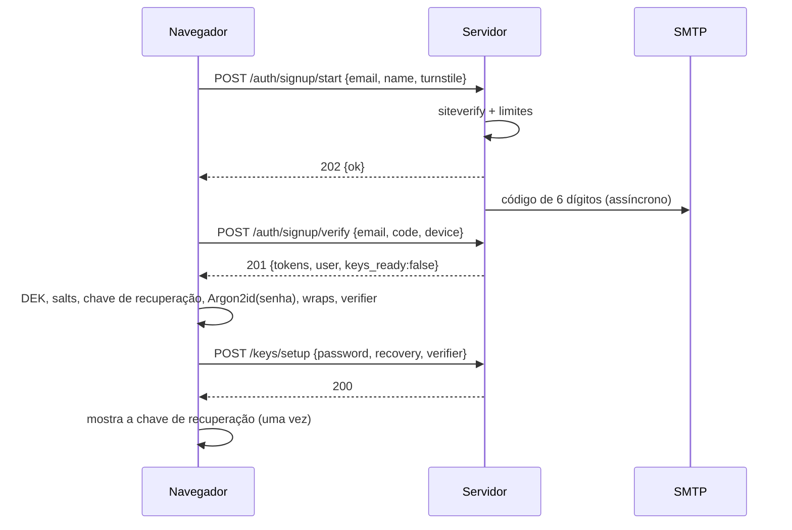

### 16.2 Login + desbloqueio (app)

```mermaid
sequenceDiagram
    participant A as App (main)
    participant W as Janela captcha
    participant S as Servidor
    A->>S: GET <base>/api/info (protocolo, captcha?)
    A->>W: abre <base>/captcha?client=app&nonce=N (só se features.captcha)
    W->>W: Turnstile
    W-->>A: navega /captcha/done#token=T&nonce=N (interceptado)
    A->>S: POST /auth/code/request {email, turnstile_token:T}
    S-->>A: 202
    A->>S: POST /auth/code/verify {email, code, device}
    S-->>A: {tokens, device_id, keys}
    A->>A: Argon2id(senha, salt) → KEK → unwrap DEK (GCM ok?)
    alt senha errada
        A->>A: "Senha incorreta" (nada vai ao servidor)
    else ok
        A->>A: subchaves; safeStorage(DEK) se "lembrar"
        A->>S: WS hello {cursor, state_cursor}
        S-->>A: welcome
    end
```

### 16.3 Merge do primeiro login

```mermaid
sequenceDiagram
    participant A as App
    participant U as Usuário
    participant S as Servidor
    A->>S: GET /account (usage.records)
    alt online vazio
        A->>S: blobs (check + PUT) e push de tudo (replay, chat_bases=0)
    else os dois têm dados
        A->>U: Priorizar online / Priorizar local?
        U-->>A: escolha
        A->>S: GET /records (tudo) e GET /chat-states
        A->>A: dedupe + remapear + decidir conteúdo (+ cópias locais de chats perdedores)
        A->>S: PUT blobs ausentes
        A->>S: POST /sync/push (lotes)
    end
    A->>A: cursor = head; sync normal
```

### 16.4 Sync normal (registro LWW com conflito)

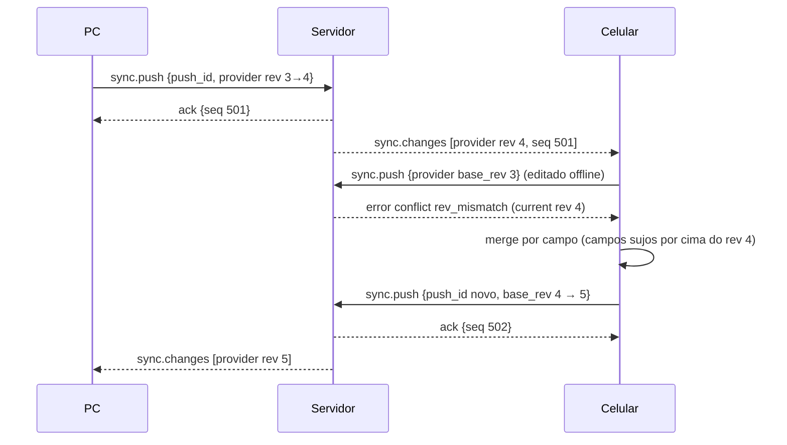

### 16.5 Turno normal no host + streaming ao vivo

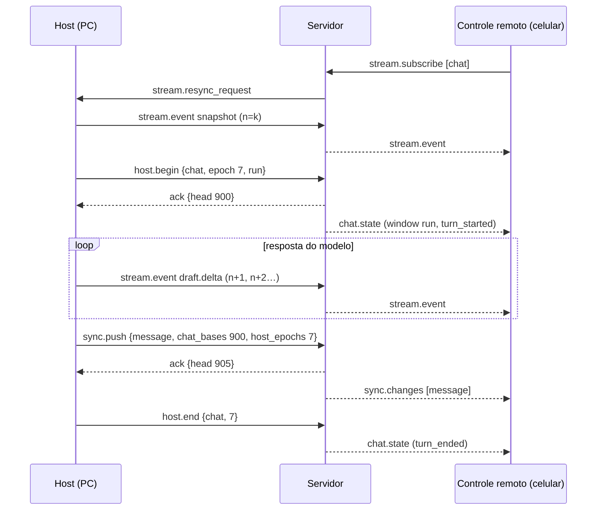

### 16.6 Envio remoto → fila do host

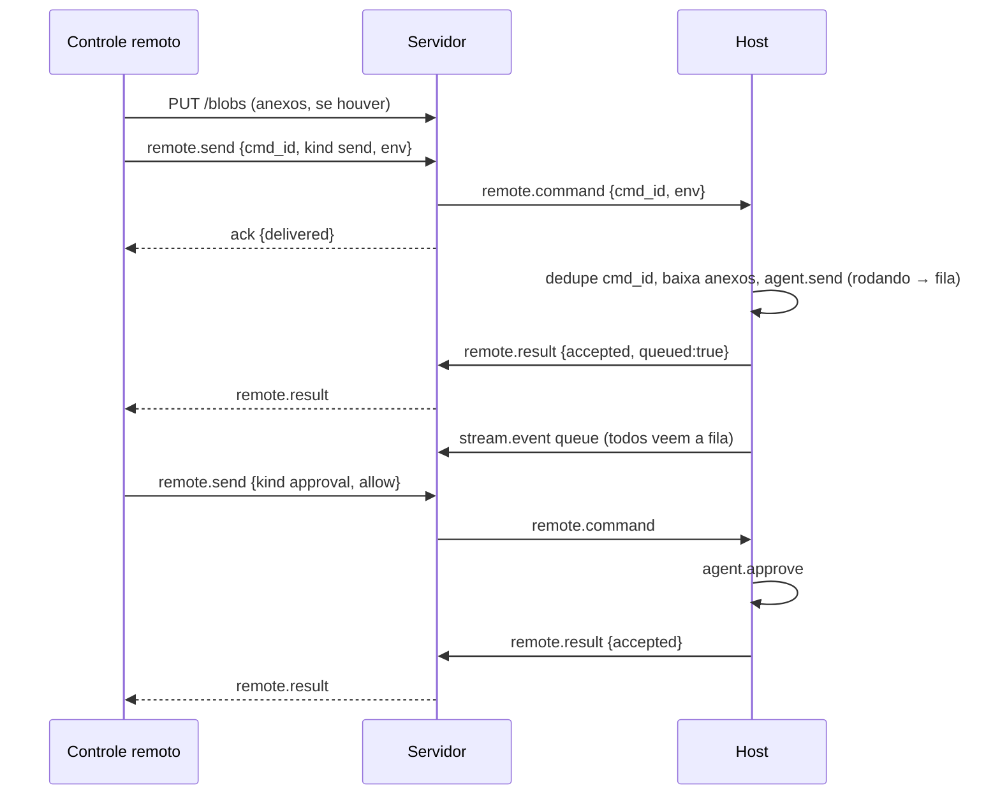

### 16.7 Queda do host (tolerância de 10 s)

```mermaid
sequenceDiagram
    participant H as Host
    participant S as Servidor
    participant R as Controle remoto
    Note over H,S: janela aberta (rodando)
    H--xS: conexão cai
    S->>S: status grace (10 s)
    alt volta em < 10 s
        H->>S: hello {active_windows:[chat, epoch]}
        S-->>H: welcome {resumed_windows:[chat]}
    else não volta
        S->>S: fecha janela, status offline
        S-->>R: chat.state {event: host_dropped} → "O dispositivo remoto (PC) caiu"
        Note over H: continua rodando offline; conteúdo vira replay
    end
```

### 16.8 Host offline e queda no meio de um comando

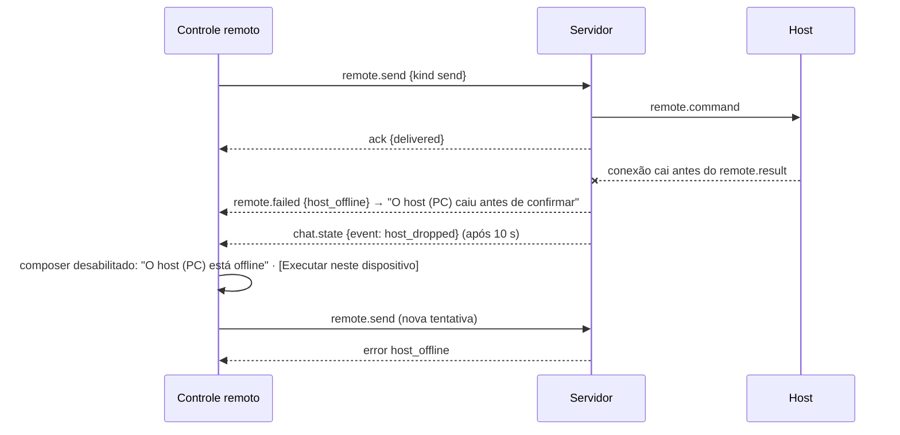

### 16.9 Assumir um host offline ("Rodar aqui")

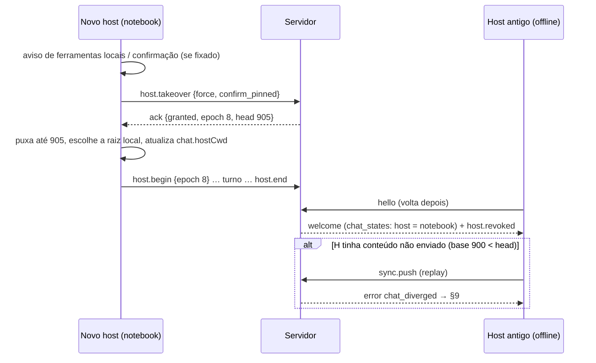

### 16.10 Trocar o host com o antigo online

```mermaid
sequenceDiagram
    participant N as Novo host
    participant S as Servidor
    participant H as Host atual
    N->>S: host.takeover {next_turn}
    S->>H: host.handover_request {to N, next_turn}
    S-->>N: ack {pending}
    S-->>N: chat.state (handover_requested)
    H->>H: termina o turno sem puxar a fila; repassa itens da fila
    H->>S: host.end {handover_pending:true}
    H->>S: host.release {epoch 7, forwarded:[send…]}
    S-->>H: host.revoked {handover}
    S-->>N: host.granted {epoch 8, head}
    S-->>N: remote.command (itens repassados)
    Note over N,S: com mode force: H faz agent.stop em tudo e libera; sem resposta em 20 s o servidor concede
```

### 16.11 Divergência e resolução

```mermaid
sequenceDiagram
    participant D as Dispositivo com versão offline
    participant S as Servidor
    participant O as Outro dispositivo
    D->>S: sync.push {chat_bases: 900} (head já é 950)
    S->>S: diverged {id X, device D, base 900, head 950}
    S-->>D: error chat_diverged
    S-->>O: chat.state {event: diverged}
    D->>S: GET /records?scope=chat (versão online)
    D->>D: usuário escolhe + confirma "a outra versão será apagada"
    alt manter local
        D->>S: POST divergence/resolve {X, keep local, items (puts + tombstones)}
    else manter online
        D->>S: POST divergence/resolve {X, keep online}
        D->>D: apaga a versão local; aplica a online
    end
    S-->>D: 200
    S-->>O: sync.changes + chat.state {event: resolved}
```

### 16.12 Troca de senha

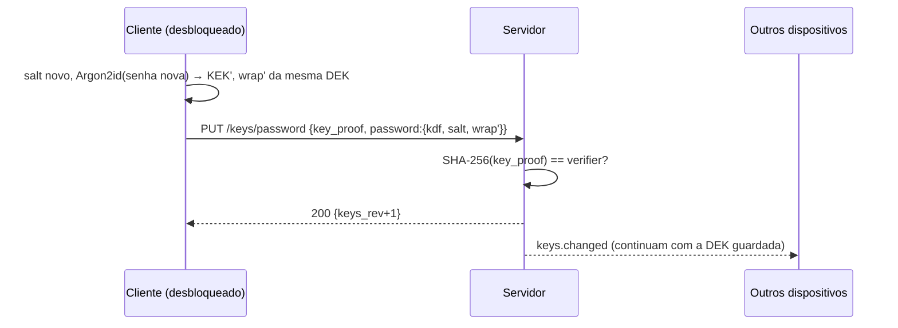

### 16.13 Recuperação

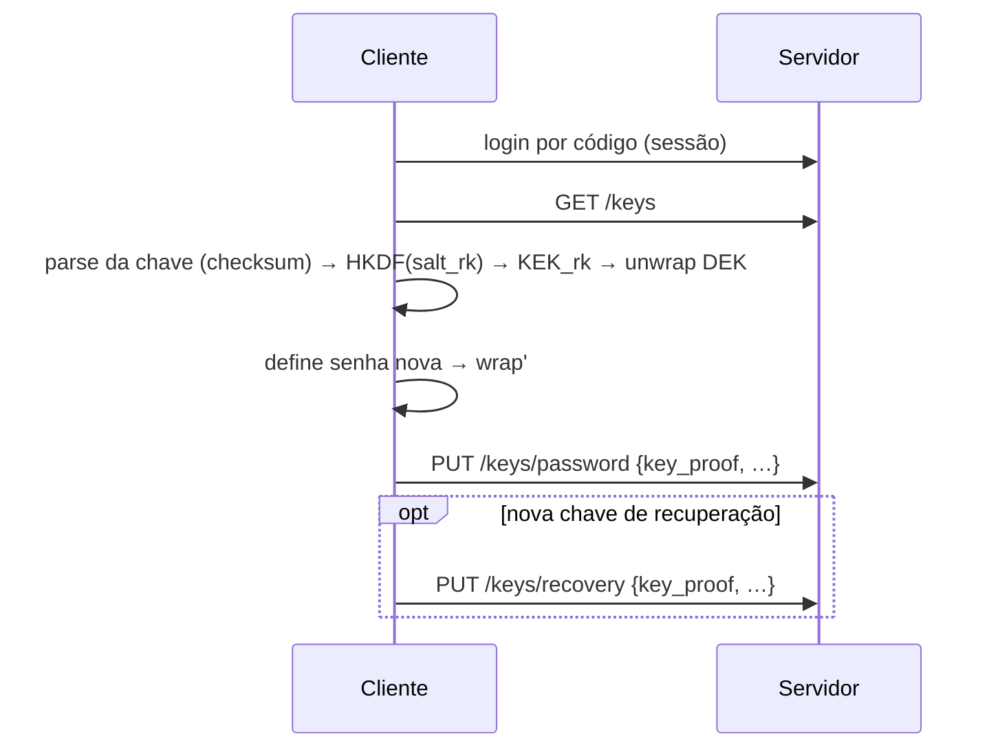

### 16.14 Skills (opt-in)

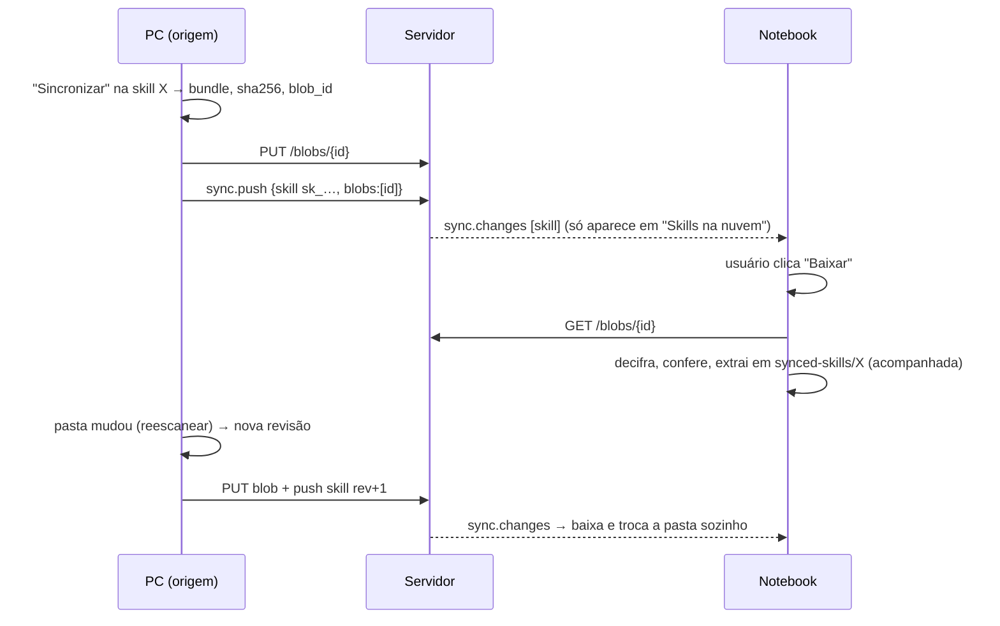

### 16.15 Anexo: upload e download

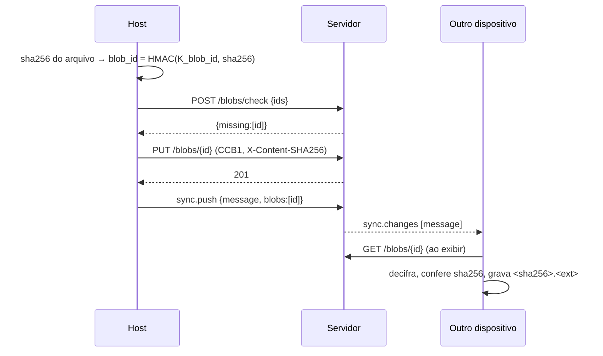

---

## 17. Limites, constantes e códigos de erro

### 17.1 Constantes

| Nome | Valor |
|---|---|
| `EMAIL_CODE_TTL_S` / `EMAIL_CODE_MAX_ATTEMPTS` | 600 / 5 |
| `ACCESS_TOKEN_TTL_S` / `REFRESH_TOKEN_TTL_DAYS` | 3600 / 60 (deslizante, rotação a cada uso) |
| `WS_HELLO_TIMEOUT_S` | 10 |
| `WS_PING_INTERVAL_S` (cliente) / `WS_PONG_TIMEOUT_S` (cliente) / `WS_IDLE_TIMEOUT_S` (servidor) | 15 / 10 / 30 |
| Backoff de reconexão | jitter total, 1 s · 2ⁿ, teto 30 s, zera após 60 s conectado |
| `HOST_DROP_GRACE_S` | 10 |
| `SERVER_RESTART_GRACE_S` | 60 |
| `HANDOVER_FORCE_TIMEOUT_S` | 20 |
| `COMMAND_RESULT_TIMEOUT_S` | 30 |
| `COMMAND_MAX_BYTES` | 1 MiB (envelope) |
| `TOMBSTONE_RETENTION_DAYS` | 180 |
| `PUSH_RECEIPT_TTL_DAYS` | 7 |
| `BLOB_ORPHAN_GRACE_H` | 24 |
| Pull: `limit` padrão / máx. / bytes por página | 500 / 1000 / 8 MiB |
| Push: itens / bytes (REST) / bytes (WS) | 500 / 32 MiB / 4 MiB |
| `sync.changes` payload inline por mensagem | 256 KiB |
| `stream.event` máx. / taxa do host | 256 KiB / ~20 eventos/s por chat (o servidor PODE descartar acima de 50/s) |
| Blob máx. por `PUT` | 300 MiB (Nginx `client_max_body_size`) — sem limite de cota por padrão |

### 17.2 Cotas

`users.quota_record_bytes`, `quota_records`, `quota_blob_bytes`, `quota_devices`: `NULL` = ilimitado
(padrão). Editáveis no painel admin. Erro: `413 quota_exceeded`.

### 17.3 Limites anti-abuso (aplicação, contadores no Postgres; Nginx na frente — ver ARCHITECTURE.md)

| Ação | Limite |
|---|---|
| `code/request` + `signup/start` por e-mail | 5/h e 10/24 h |
| idem por IP | 20/h e 100/24 h |
| `code/verify` por código | 5 tentativas |
| `code/verify` por e-mail / por IP | 10/h / 30/h |
| bloqueio por e-mail | 15 falhas (≈ 3 códigos queimados) em 24 h → 1 h; reincidência dobra até 24 h |
| `auth/refresh` por dispositivo | 60/h |
| conexões WS por usuário | 30/min |
| `reauth/request` por conta | 5/h |

Contadores por e-mail usam `HMAC(SERVER_SECRET, email)` e valem também para e-mails inexistentes —
responder `429` não revela se a conta existe.

### 17.4 Códigos de erro

| `code` | HTTP | Quando |
|---|---|---|
| `invalid_request` | 400 | corpo/parâmetros inválidos |
| `captcha_failed` | 400 | Turnstile inválido/expirado/ação errada (ou ausente com captcha ligado) |
| `signup_closed` | 403 | cadastro fechado na instância e sem convite |
| `invite_invalid` | 400 | convite inexistente, usado, expirado ou de outro e-mail |
| `code_invalid` | 400 | código errado, expirado, esgotado ou e-mail inexistente |
| `unauthorized` | 401 | sem token / expirado (`details.reason: 'expired'` → refresh) |
| `refresh_reused` | 401 | refresh antigo reutilizado (dispositivo revogado) |
| `forbidden` | 403 | sem permissão |
| `account_disabled` | 403 | conta banida (só após autenticar) |
| `device_revoked` | 403 | dispositivo revogado |
| `key_proof_invalid` | 403 | `key_proof` não confere |
| `not_found` | 404 | recurso inexistente |
| `keys_not_ready` / `keys_already_set` | 409 | setup de chaves |
| `conflict` | 409 | push com conflitos (`details.conflicts`) |
| `blob_missing` | 409 | push referencia blob não enviado (`details.missing`) |
| `chat_busy` | 409 | janela aberta por outro dispositivo / apagar chat rodando |
| `chat_diverged` | 409 | chat divergente (`details.diverged`) |
| `divergence_discarded` | 409 | sua versão já foi descartada (`details.divergence_id`) → apagar a versão local e baixar a online |
| `divergence_mismatch` | 409 | `divergence_id` velho / dispositivo errado |
| `stale_base` | 409 | `chat_bases` maior que `head` |
| `not_host` | 409 | não é o host / epoch velho (`details.state`) |
| `no_host` | 409 | chat sem host e quem pede não pode hospedar |
| `cannot_host` | 409 | dispositivo sem `can_host` |
| `host_offline` | 409 | comando remoto com o host fora (offline/tolerância) |
| `host_pinned` | 409 | host fixado sem `confirm_pinned` |
| `handover_pending` | 409 | troca de host em andamento |
| `cursor_expired` | 410 | `since` abaixo do piso de tombstones |
| `payload_too_large` | 413 | lote/frame grande demais |
| `quota_exceeded` | 413 | cota (`details.kind/used/limit`) |
| `protocol_unsupported` | 426 | versão do protocolo fora da faixa |
| `rate_limited` | 429 | limites (`Retry-After`) |
| `internal` | 500 | erro inesperado |

---

## 18. Versionamento

- **Versão do protocolo** `MAJOR.MINOR.PATCH` no topo deste arquivo. MAJOR = incompatível (rotas
  `/api/v2`, `hello.protocol: 2`); MINOR = adições compatíveis (campos/tipos/mensagens novos que os
  clientes antigos ignoram); PATCH = só texto.
- `GET <base>/api/info` (`protocol.min`/`protocol.max`) e o `welcome` (`protocol`) informam as versões. O servidor DEVE manter o MAJOR anterior
  por um período de transição quando houver um novo.
- Versões independentes: `v` do envelope (formato cifrado), `k` da DEK, `sv` de cada esquema de registro.
  Leitor que encontrar `v`/`k` desconhecido NÃO DEVE decifrar nem sobrescrever o registro (pede
  atualização); `sv` maior que o conhecido: ler o que entende, preservar o resto.
- **Regra dos dois repositórios**: toda mudança aqui → mesma mudança em `ClearChat/docs/SYNC_PROTOCOL.md`
  e `ClearChatWebsite/docs/SYNC_PROTOCOL.md` (arquivos idênticos), `generate.ts` + vetores regenerados nos
  dois, versão incrementada, entrada no changelog abaixo.

### Changelog

| Versão | Data | Mudança |
|---|---|---|
| 1.0.0 | 2026-10-19 | Contrato inicial (cripto, registros, REST, WebSocket, host de execução, divergência, merge, skills, anexos, instância/self-host, gateway reservado). |

---

## 19. Notas de implementação do cliente (não normativo)

Tabelas locais sugeridas no SQLite do app (não fazem parte do contrato):

```sql
sync_state(key TEXT PK, value TEXT)          -- user_id, device_id, cursor, state_cursor, server_url, keys_rev
sync_records(type TEXT, id TEXT, rev INTEGER, seq INTEGER, deleted INTEGER, PRIMARY KEY(type, id))
sync_outbox(oid INTEGER PK, type, id, scope, base_rev, dirty_fields TEXT, deleted INTEGER, chat_base INTEGER NULL, created_at)
sync_chat(chat_id TEXT PK, head INTEGER, local_cwd TEXT, needs_refetch INTEGER, offline_dirty INTEGER)
sync_blobs(sha256 TEXT PK, blob_id TEXT, uploaded INTEGER)
sync_commands_seen(cmd_id TEXT PK, at INTEGER)   -- dedupe de comandos remotos (host), 7 dias
sync_remote_pending(cmd_id TEXT PK, chat_id, payload_json, status, created_at)   -- enviados como controle remoto, aguardando resultado (só em memória basta)
sync_skills(name TEXT PK, record_id, mode TEXT /* source|copy */, local_dir, bundle_sha256, rev)
```

- O sync roda no **processo main** do Electron (rede, SQLite, DEK); o renderer recebe eventos
  (`AgentEvent` + novos: estado de host, divergência, progresso de sync).
- Hooks no app: cada escrita dos repos (`providersRepo`, `chatsRepo`, `messagesRepo`, `MemoryStore`…)
  registra no outbox (com `dirty_fields`); o runner abre/fecha a janela (`host.begin`/`host.end`) e
  publica os eventos do stream; `agent.send` num chat cujo host é outro dispositivo vira `remote.send`.
- O `cwd` local de cada chat sai do `config_json` antes de cifrar e volta ao aplicar (guardar em
  `sync_chat.local_cwd` ou manter no próprio `config_json` local e ignorar o campo remoto).
- Ao aplicar `chat` remoto novo sem `cwd` local: usar `defaultCwd` (ou home) e pedir ao usuário só ao
  virar host.
- Mobile: pull com `payload=0` + `records/fetch` sob demanda; não segurar host em segundo plano (o SO
  derruba o WS → host offline em 10 s).

---

## 20. Instância, configurações da instância e self-host

### 20.1 Escolha do servidor no app (estilo Jellyfin)

- Configurações → Conta → **Servidor**: "**ClearChat** (clear.ezenere.com)" (padrão) ou "**Self-host**"
  com um campo de endereço `esquema://host[:porta][/caminho]` (sem esquema → `https://`; `/` final
  removido). Variável de ambiente `CLEARCHAT_SYNC_URL` sobrepõe (desenvolvimento/testes).
- Antes do login o app valida com `GET <base>/api/info`: resposta válida, `protocol` compatível, e mostra
  o `name` da instância ("Entrar em <nome>"). Erro de rede/TLS/protocolo → mensagem clara e não continua.
  `http://` só é aceito com aviso ("sem criptografia de transporte — use só em rede local"; os dados
  continuam cifrados ponta a ponta, mas tokens e metadados não).
- A UI se adapta às `features`: "Criar conta" só com `signupOpen`; janela de captcha só com `captcha`.
- Trocar de servidor = logout da instância atual (dados locais ficam) + login na nova → merge do primeiro
  login (§12). Um app fala com **uma** instância por vez.
- Tudo que o app abre no navegador usa `<base>` (cadastro, setup, painel).

### 20.2 Configurações da instância (painel admin, persistidas no banco)

| Configuração | Padrão | Efeito |
|---|---|---|
| `instance_name` | `ClearChat` | nome exibido no site, nos e-mails e no app ("Entrar em <nome>") |
| `signup_open` | `true` (oficial) / `false` recomendado em self-host | cadastro público on/off (§5.1); fechado → só convites ou usuários criados pelo admin |
| `landing_enabled` | `true` | off → a raiz do site mostra só login/painel (sem landing) |
| `captcha_enabled` | `true` | só tem efeito se `TURNSTILE_SITE_KEY`/`TURNSTILE_SECRET_KEY` estiverem no `.env`; sem chaves, captcha fica desligado de qualquer forma |
| `gateway_enabled` | `false` | reservado (§21); v1 ignora |

Lidas pelo backend a cada requisição relevante (cache curto) e expostas em `GET /api/info`. Segredos
(SMTP, Turnstile secret, `SERVER_SECRET`, `ADMIN_TOKEN`) ficam no `.env`, nunca no banco.

### 20.3 Self-host (resumo — passo a passo em ARCHITECTURE.md / README do servidor)

- O servidor roda em qualquer host/porta/caminho: `PUBLIC_BASE_URL` no `.env` define `<base>` (links de
  e-mail, `base_url` do `/api/info`, verificação do hostname do Turnstile, cookie `Path`). A API fica em
  `<base>/api`, o WebSocket em `<base>/ws`, o site em `<base>/`.
- CORS: desligado por padrão (site na mesma origem; apps nativos não precisam). `ALLOWED_ORIGINS` (lista)
  libera origens extras quando o site é servido de outro lugar.
- Captcha opcional (sem chaves Turnstile → sem captcha; limites continuam). E-mail via SMTP próprio.
- Painel admin sempre só em `127.0.0.1` (túnel SSH), também em self-host.

---

## 21. Fase futura (opcional): servidor como gateway de execução

> **Não faz parte da v1. Interpretação ainda a confirmar com o usuário.** Esta seção só reserva espaço no
> protocolo; nada aqui deve ser implementado agora.

Ideia: uma opção da instância (`gateway_enabled`) para o **servidor** servir de host de execução de um
chat quando nenhum dispositivo host estiver online (ex.: conversar do celular com o PC desligado).

- **Quebra o zero-knowledge** para o que o gateway executa: ele precisa das chaves de API dos provedores
  e do histórico do chat em claro. Portanto: opt-in explícito **por usuário e por chat**, com avisos
  claros, e revogável.
- **Concessão de chaves**: o cliente cifraria para a chave pública do gateway só o necessário (ex.: as
  chaves do chat/provedor, ou uma subchave) num registro do tipo reservado `key_grant`; revogar = apagar
  o registro. O mecanismo exato (subchaves por chat vs. DEK) fica para o design da fase.
- **Sem acesso ao sistema de arquivos dos dispositivos**: tools locais indisponíveis (no máximo um
  workspace isolado no servidor).
- **Arquitetura provável**: um runner headless (serviço Node reaproveitando o núcleo do agente do app)
  que se registra como dispositivo `client: 'gateway'` e participa do modelo de host (§8) como qualquer
  host — janela de escrita, comandos remotos, stream.
- **Espaço reservado em v1**: `device.client = 'gateway'`, `features.gateway` no `/api/info`, configuração
  `gateway_enabled`, tipo de registro `key_grant`. Servidores e clientes v1 tratam tudo isso como
  desligado/desconhecido.
